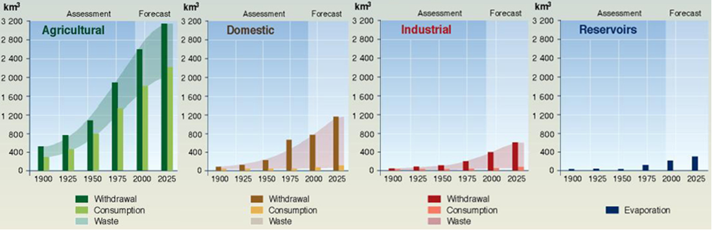
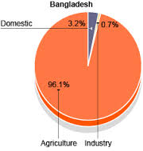
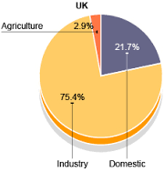

## Water

​Water is a scarce and **limited resource**. There are many uses, such as:

### Uses of Water

* **Agriculture:** to water plants
* **Industrial:**
  * Heated to make steam to turn turbines
  * Cooling down reactors
* **Domestic:**
  * Household e.g. cooking, cleaning, drinking
  * Recreational, e.g. swimming, sports
* **Environmental:** preserving water in a dam

**Evolution of Global Water Use**

**Water Use in Different Economies**

|LEDC - Bangladesh|MEDC - UK|
|:---|:---|
|||

---

### Methods of Water Supply

* **Dams:** barrier placed across a river made from concrete
* **Reservoirs:** the artificial lake that develops behind a dam
* **Wells:** a shaft sunk into the ground to obtain water
* **Desalination:**
  * **Thermal:** evaporation of water to remove salt
  * **Reverse Osmosis:** forces water through semi-permeable
    membrane to remove salt
* **Sewage Treatment:**
  * Removal of contaminants from wastewater & household sewage
  * Requires physical, chemical & biological processes to remove all
    the contaminants and make safe

### Causes of Water Shortages

* **Population Growth:** increased pressure on water sources as
  world's population grows
* **Pollution:** water sources are being polluted by industries
* **Demand:** as development increases globally, so does the amount of water needed
* **Sewage:** lack of proper sewage treatment means that waste is
  often pumped directly into water sources
* **Climate Change:** global warming may be releasing freshwater from
  glaciers & ice shelves, but much of it is running directly into
  oceans; inaccessible
* **Political:** water sources are often shared; some people control
  large percentages of the shared resource, leading to shortages for
  others
* **Mismanagement:** water is used inappropriately, causing water shortages

### Impact of Water Shortages

* **Drought:** below-average supply of water over a prolonged period
* **Famine:** crops fail/livestock die due to water shortage
* Conflict arises when sharing a limited supply of water
* People may be forced to relocate due to famine/drought
* Stagnant dirty water = increased risk of diseases
* Eutrophication due to run-off
* Dirty water/eutrophication causes loss of biodiversity
* **Eutrophication:**
  * Run-off from farms containing fertiliser causes excess growth of
    algae in water
  * Water does not oxygenate properly/receive light
  * Causes plants & animals to suffocate & die

### Solutions to Water Shortages

* **Desalination:** governments should invest more in desalination
  plants
* **Sewage Treatment:** governments should enforce better policies regarding disposal and reuse of wastewater
* **Conservation:**
  * Half-flush toilets & showering instead of bathing
  * Watering the garden at dusk to prevent evaporation
  * Collecting rainwater to use in the garden
  * Using appropriate plants for the climate
  * Using drip irrigation rather than sprinklers
* **Water Charities:**
  * Building wells to access groundwater
  * Building toilets to reduce sewage & pollution
  * Teaching appropriate farming techniques
  * Low-cost schemes to filter and clean water
* **Irrigation Projects:** use irrigation systems to redistribute
  water & water the land