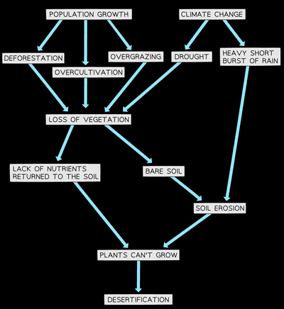

## Environmental Risks of Economic Development

### Threats to the natural environment

* **Soil Erosion:**
  * Occurs in farms, where rainforest is cleared – soil is washed away by rain because there are no tree roots to retain it
  * In the Amazon rainforest, eroded soil goes into rivers & pollutes drinking water
* **Global Warming:**
  * Occurs due to too much greenhouse gases
* **Greenhouse Effect:**
  * When infrared radiation passes through the atmosphere, & some is absorbed and re-emitted in all directions by greenhouse gas molecules
  * This warms the surface & lower atmosphere
* **Effects:**
  * Melting poles = rising sea levels = increase in storms
  * Change in the distribution of precipitation
  * Plants and wildlife might not have time to adjust
  * Lower crop yields in Africa, Asia & Latin America
  * More people at risk from insect/water-borne diseases
* Greenhouse gases are:
  * CO2 from burning fossil fuels or wood
  * Methane from decomposing organic matter & waste
  * CFCs from aerosols, air conditioners, & refrigerators
  * Nitrogen Oxides from car exhausts & power stations
* **Air pollution:**
  * Carbon monoxide: incomplete combustion of carbon-containing substances causes oxygen starvation
  * Sulphur dioxide: combustion of fossil fuels causes respiratory problems and acid rain
  * Nitrogen oxides: N2 & O2 from air combine due to heat (furnace/engine); same effect as Sulphur dioxide
  * Lead oxide: burning leaded petrol damages nervous system
* **Water Pollution:**
  * Chemicals in fertilizers cause eutrophication
  * Oil spilling into the sea
  * Acid rain destroys lakes and kills animals/plants
  * Health hazards for humans
  * Damages limestone buildings and sculptures
  * Fewer crops can be grown on an acidic field
* **Noise Pollution:**
  * Vehicles
  * Machinery in industries and farms
  * Noisy humans
* **Visual Pollution:**
  * All man-made things are ugly compared to unspoiled nature
* **Desertification:**
  * Overgrazing
  * Soil erosion
  * Global climate getting warmer - gets drier due to less rain
  * Deforestation - fewer roots of trees to hold the soil together

---

### **Sustainable Development and Management:** 

**Sustainable Development**

* Economic development without destroying natural resources

**Management:**

* Population policies
* Sustainable tourism
* Use of renewable energy
* Afforestation

**Resource Conservation:** Meeting needs of the present without affecting needs for the future

* **Ways of Conservation:**
  * 3 Rs: reduce, reuse, recycle
  * Renewable energy
  * Use energy-efficient products
  * Restrict the use of resource
  * Use more public transport
  * The government can raise tax on petrol prices