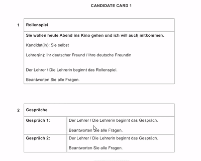

# Role Play

## Scenario Card (1)

* The card explains the scenario of the roleplay, and you have 10 minutes to prepare.
* You will be asked five questions.
* This part of the exam is worth 10 marks.
* During these 10 minutes you can imagine the questions that could be asked e.g., Wann sollen wir die Wanderung machen? Für wie lange möchtest du wandern?
* You will not be able to see the questions, you will only hear them on the spot.
* If you did not hear a question you can say: Wie bitte? Or Noch einmal bitte. Do not say Ich habe nicht verstanden or ich verstehe nicht, this will cause the examiner to move on to the next question.

Before the exam (1st part) you will get a card that looks like this:

 