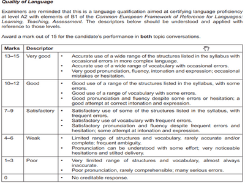

# Topic Conversation

## Answer Criteria

For the 2nd part of the exam:

* You get 2 topic conversations to talk about and each topic is 5 questions.

  * Your answer should be longer, you should provide information, explanation and opinion.
  * Minor errors are tolerated as long as they do not impede communication.

* This part of the exam should be at least 3½ minutes or maximum 4 minutes long.

* You do not get to see the questions, you hear them on the spot.

  \
  