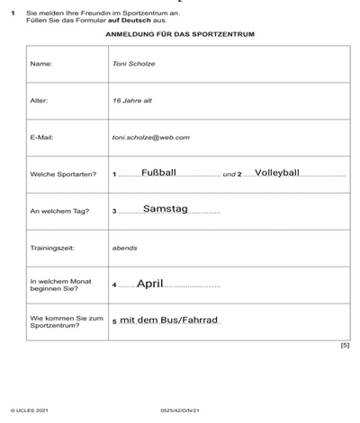

# Introduction

## Types of Questions

* The first question is a 5-mark question requiring you to fill in the blanks with the **appropriate** answers.

**~~Solved example of the first question:~~**

 

* The second question is a 12-mark question. You are required to write 80 to 90 words.
* And the third and last question, you can choose between 2 writing pieces. Either an E-Mail or an article. It is worth 28 marks and requires 130 to 140 words.
* **__Note that you get an extra 10 words, a maximum of up to 100 in both writings.__**

