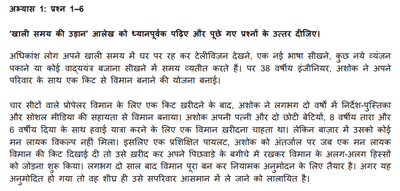

# Reading Comprehension

## Short Answers

* Skim through the passage

* Then read the questions

* Read the passage again (underline the answers so it is easy for you to check later)

* Look for synonyms from the paragraph because the question may not use the exact same words

* Write the answers in simple sentences

* Allot 20 minutes for this Question

* If the blanks are given in a bullet form, separate the answers into distinguished points (in simple sentences)

Example:

(0549_w24_qp_01)

Sample Answer for this passage:

Q. खाली समय में अशोक ने क्या बनाया?

A. खाली समय में अशोक ने विमान बनाया था।