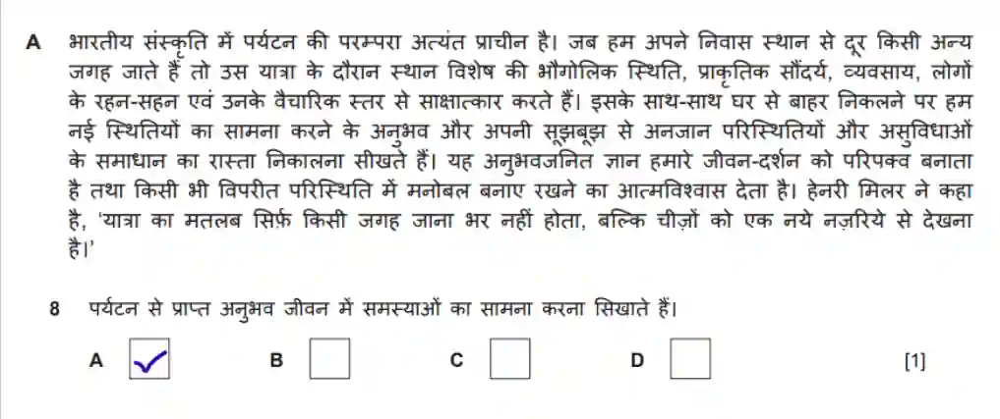

## MCQ

**Steps**

* Read passage A carefully

* Go through the questions

* Mark the questions with a pencil for which you think the answer is A

* Repeat for passages B, C and D

* You could even read the questions before and go ahead with the steps given above

* Read the whole comprehension thoroughly

* Once you are confident in your answers, mark them with a pen

  **Tips**

* Allot 15 minutes for this question

* You can underline the keywords in the question and the paragraph for easier last minute checking

Note: Make sure your tick does not go out of the MCQ box

**Sample Question with Answer:**

(0549_w24_qp_01)