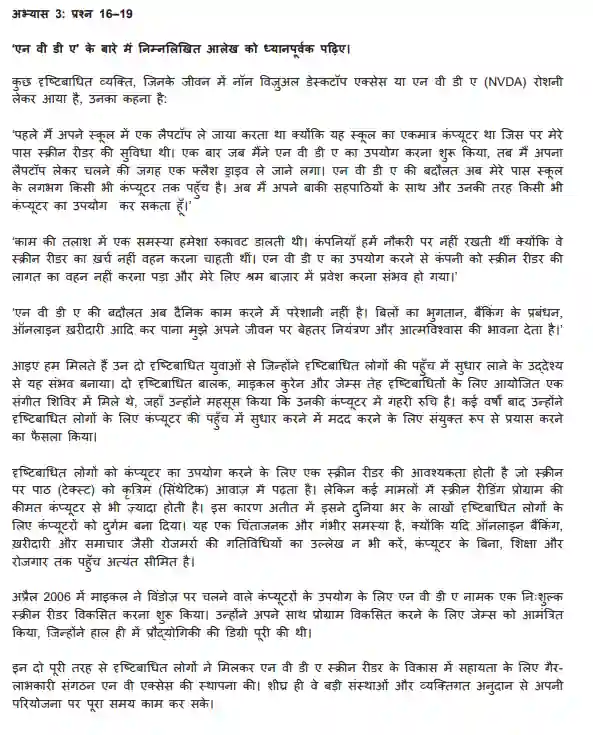

# Note Making and Summary

## Note Making

* Read the passage carefully

* Go through the questions

* Look for who, what, why, how to understand the main idea

* Skim through the paragraph and underline the key words

* Write the answers in simple and concise sentences as much as possible

* The answers have to be written in sort of a pointer format, as shown below

* Keep the language neutral and stick to the content in the paragraph

  

  0549_w24_qp_01

Example:

Q. दृष्टि बाधित लोगों की समस्या [3]

Answer:

* महंगे स्क्रीन रीडर विद्यार्थियों को उपलब्ध नहीं

  OR स्कूल मे लैपटॉप लेकर जाना पड़ता था क्योंकि स्कूल में एक ही कम्प्यूटर में स्क्रीन रीडर था।

* आजीविका के अवसर न मिल पाना \|

* ददैनिक जीवन की ज़रूरत, ऑनलाइन बैंकिंग आदि में समस्या \|