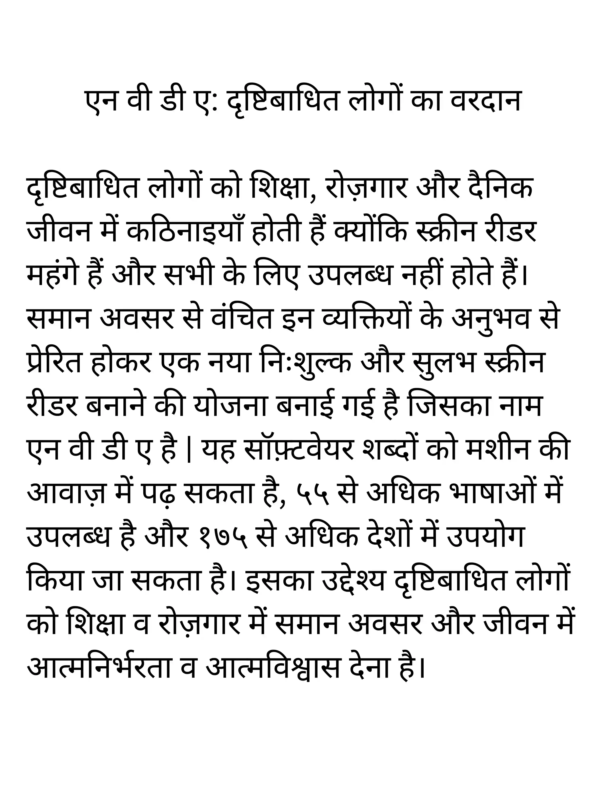

## Summary

* Underline the main idea or annotate it (in a few words) on the question with a pencil

* A title is required

* The title doesn’t have to be very fancy, it should just capture the main idea of the summary

* You have to use the points you wrote in the note making question

* The summary should be within 100 words

* Combine related points --> remove repetition --> keep only the “essence”

* Don’t end the summary with a question

* Use as many linking words as possible

* The summary should be in a single continuous paragraph

**Marking Scheme**

Content: 4 marks

Makes 4 clear points that answer the question.

Language: 6 marks

Very good attempt to use own words and to organise and sequence points cohesively. A concise summary. Wide range of vocabulary and grammatical structures, used accurately. Assured control of punctuation and spelling.

**Example**

Let’s take the passage used earlier for the sample summary.

It should look something like this:

