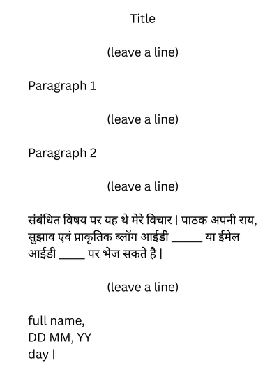

## Blog Writing (ब्लॉग लेखन)

* Usually given for 8 marks

* Similar to an essay

* Checklist

  1. the tone is informative/persuasive and not argumentative

  2. the blog has a proper introduction and conclusion

**Format**

