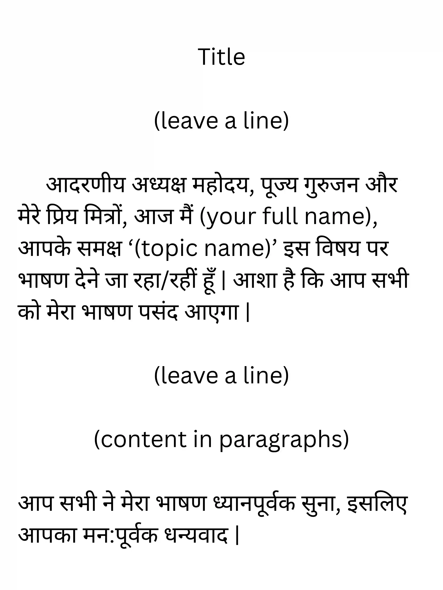

## Speech Writing (भाषण लेखन)

* Usually for 16 marks

* Checklist

  1. the tone is informative/persuasive

  2. there are both: facts and opinions in the speech

  3. has to be somewhat formal (you will mainly be asked to write speeches for a school event)

Lets say the topic is about cleanliness, start with your and the topic’s introduction.

Then start with stating the current situation of cleanliness in the country, then dive deeper into the issue, referring to the mindset and habits of the citizens.

To conclude, you could give off some solutions to maintain cleanliness in the country and the closing line could say that you hope that the citizens take cleanliness seriously.

Then end the speech with the lines given at the very end of the format.

**Format**

