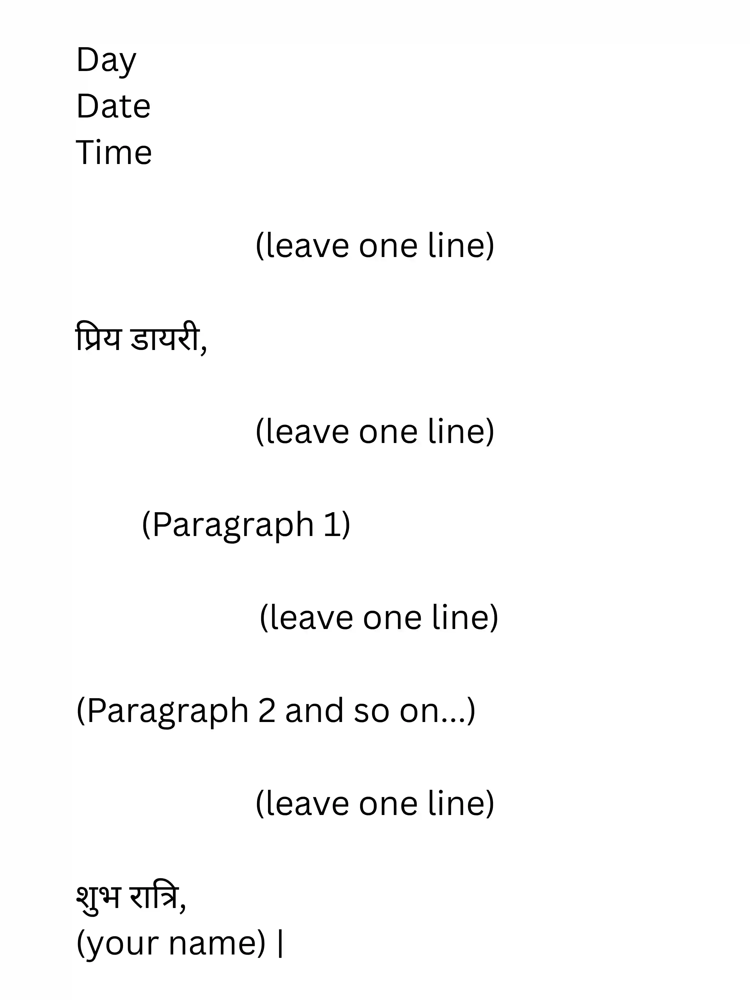

## Diary Writing (डायरी लेखन)

* Usually for 8 marks

* You have to come up with events that happened on a particular day

* You can give conclusion by saying: मैं इस डायरी को यहीं विश्राम देता/देती हूँ \|

* Checklist

  1. written in first person perspective

  2. sounds personal (opinions and emotions)

  3. includes the things you saw and experienced

  4. tone is informal (but no slangs please)

**Format**

