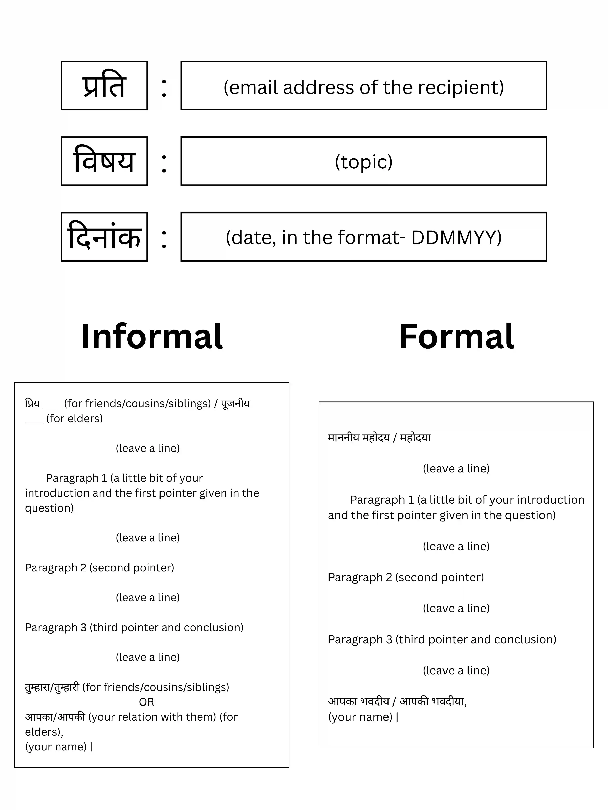

## Email Writing (ई-मेल लेखन)

* Usually for 8 marks

* Checklist

  1. the tone is according to what is given in the question (formal/informal)

  2. for the formal one, make sure you properly introduce yourself briefly at the very start

  3. all the points in the question are addressed

**Format**

