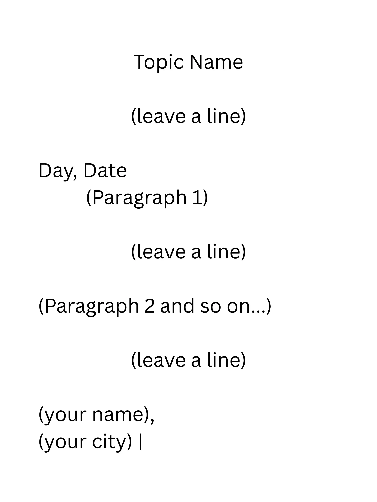

## Article Writing (लेख लेखन)

* Usually for 16 marks

* Similar to essay writing

* Checklist

  1. tone: informative/persuasive and semi-formal

  2. all the points given in the question are addressed

**Format**

