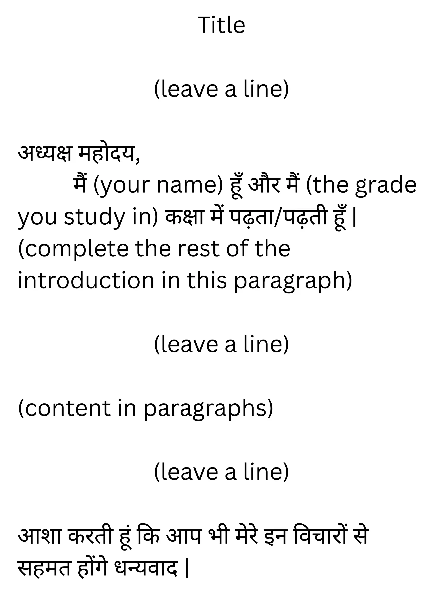

## Debate (वादविवाद)

* Usually for 16 marks

* A topic will be given and you have the freedom to choose whether you want to write for or against the topic

* You have to clearly state which side you’re on

* You have to make 1-2 points your opposition would say and then explain your counter argument accordingly

* Checklist

  1. tone: argumentative but respectful

  2. your points are convincing

  3. the composition is addressed to the judge

**Format**

