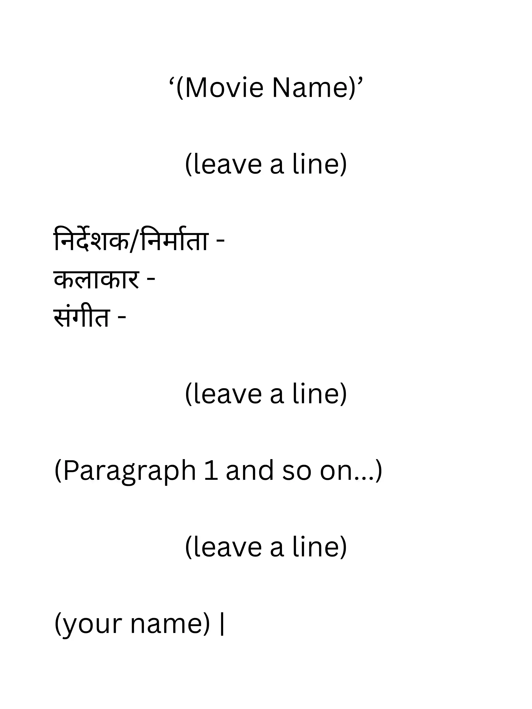

## Film Review (फिल्म समीक्षा)

* Usually for 8 marks

* You have to first explain the main idea of the movie (in short; without any spoilers)

* Then explain what you liked/disliked about the movie

  for example: it could be about the pace of the movie or its ending

* At last, give its rating out of 5

* Checklist

  1. has your opinions in it

  2. is in first person perspective

  3. composition gives details about the movie and does not directly jump into your views on it

**Format**

