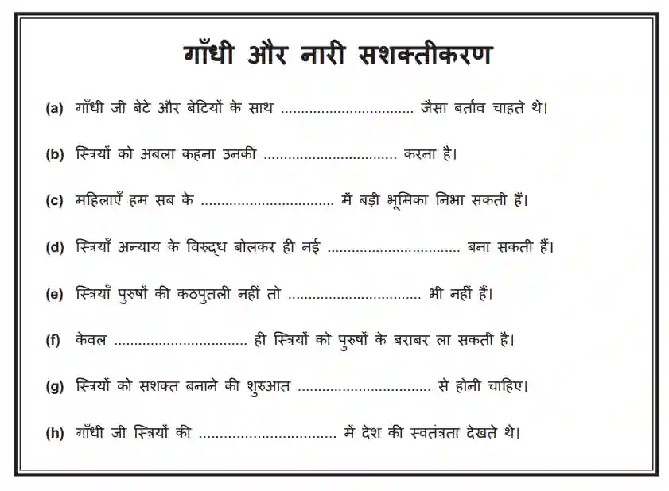

# Question 2

* Fill in the blank questions

* Listen carefully, because the recording often includes extra info to confuse you

* After filling in, re-read the sentence

  If it sounds wrong or unnatural, you may need a different synonym

Sample Question:

If you are struggling to keep up, focus on the odd number questions for the first recording and write them down, then do the same for the even number questions for the second recording.

Remember to check grammar and verb agreement to score full marks.