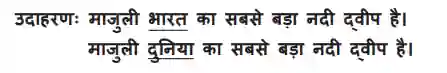

# Question 3

* Fill in the blank question

  where you have to replace the incorrect answer with the correct one

* Pay attention to the idea of the passage, because the answers are sometimes given indirectly

* You might have to use a synonym for the answer sometimes because it might not fit well in the sentence

the questions look like this (in a continuous series of around 8 questions)