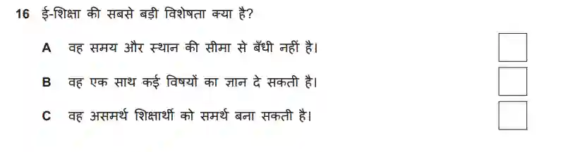

# Question 4

* MCQ based question

* Generally easy to solve

* Read all the options carefully before the recordings start

* Just make sure that when you tick the answer, it does not go out of the box

* Solve it with a pencil in the first hearing

* And then use pen after the second hearing, when you are sure of the answer

* Look out for similar words in the options, as the answers may not be direct

* Select the option that fits best to the idea of the audio in that particular question

  

  the questions look like this