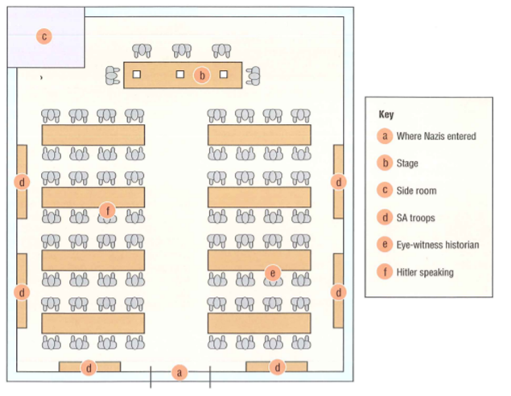

## The Munich Putsch: Success or Failure?

* **Why did Hitler attempt a Putsch?**
  * Hitler thought Stresemann’s policies were making Germany look weaker.
  * He thought the German army could be persuaded to abandon the government and support them
  * He thought that since the Bavarian government was right – winged, they would also support Hitler in overthrowing the government
* **8 November 1923**: **The Beer Hall**
  * On November 8, the Bavarian Prime Minister was addressing a meeting at a beer hall in Munich
  * Then Hitler and 600 SA troops barged into it and stood on a metal chair and spoke while the Prime minister was held at gunpoint in another room

     
  * Once done, He let Kahr and the others go and then headed for Munich
* **9 November 1923**: **The March on Munich**
  * After Kahr was released, he delivered the news to Berlin, and they ordered the army to crush the putsch
  * On the morning of 9 November, Hitler and 3000 Nazi’s marched into the city centre and found the Army and Police waiting for them
  * Then, shots were fired, and Hitler ran as he was injured while Ludendorff was captured.
  * Hitler was arrested two days later
* **February 1924: The trial**
  * In February 1924, the leaders of the putsch were put to trial on the charge of Treason, however the right – wing judges treated him leniently and sentenced him only 5 Years in Jail.
  * His prison was in a castle, and he wrote the famous book Mein Kampf there and served just 9 months of the sentence and could meet anyone during the time.
  * The Nazi party was also banned and were forbidden from taking part in the Reichstag elections.

