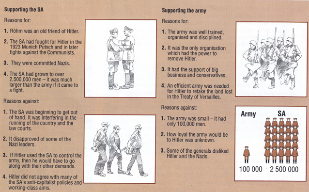

## The SA or the Army?

* **By Mid-1934 a power struggle had developed in the Nazi Leadership. It was a choice between the SA and the Army**
* **The SA:**
  * Throughout the rise of the Nazi’s, Hitler depended on the SA to put his policies into action
  * By 1934, the SA were an enormous organisation with over 2 million Members
  * However, with the SA being so large they were a potential rival to Hitler, especially their Leader Ernst Rohm.
  * Hitler also didn’t agree with some of the Policies Rohm wanted to implement
* **The Army:**
  * The army was much smaller, only of 100,000 men due to restrictions by the Treaty of Versailles
  * They wanted new and improved weapons such as Tanks and were very suspicious of Rohm.
  * Many army chiefs were also suspicious of Hitler due to his plans to fight France but mainly agreed on him for re-arming Germany.

 

* **The Night of the Long Knives**
  * On 30 June 1934, Hitler called a meeting of SA leaders at the Hansel Bauer Hotel in Wiessee, Bavaria.
  * Hitler arrives with the SS and Rohm and the Main leaders were all shot dead
  * Hitler also takes the opportunity to settle some personal scores against opposition party leaders, Journalists who had published negative articles about him, and many more, killing a total of 200 people or more.
  * The Army, now satisfied that they wouldn’t be replaced, pledged total allegiance to Hitler.
* Hitler’s Power was now obsolete, with opposition eliminated and the Army on his side, Hitler officially was the dictator of Germany.

