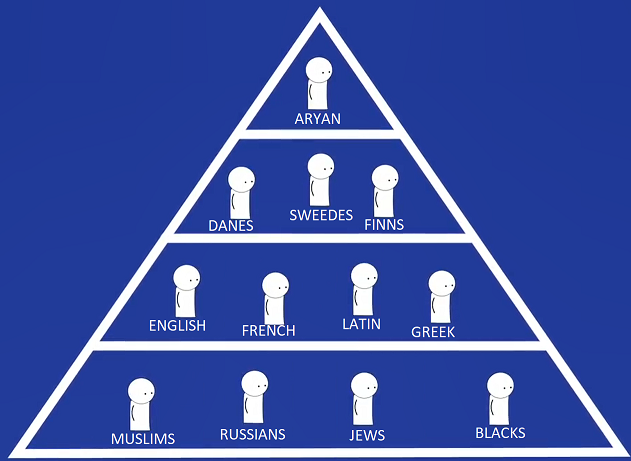

# What were the Nazi’s trying to achieve and did they try to achieve it?

## What kind of Germany did the Nazi’s want to create?

* **Aim 1: A strong Germany:**
  * The Nazi’s believed many of the problems had been caused by the weak leadership of the Weimar Government
  * Hitler wanted a strong Germany that would make them a strong Government, a strong military power, and a strong thriving economy.
  * This would help him overturn the Treaty of Versailles, Invade France and restore prosperity of the German people
* **How would they achieve it?**
  * For this to occur, Germany needed a strong, forceful, and decisive leader and Hitler was just the man
  * Within days of him being appointed chancellor, He met with many of his army leaders to tell them his plans of re-arming Germany
  * He wanted German Industries as powerful as they had been before the First world war and so funded infrastructure projects like the Autobahn and reduced unemployment numbers by privatising state industries.
* **Aim 2: A Radical Germany:**
  * Hitler believed in a “Racial Pyramid” where one race will be superior to the rest and believed the purest of which were “Aryans” and worst were Jews.
  * He believed that Germany’s past problems had been created since Germany was not run by racially pure Aryans.

   
* **How would they create it?**
  * Hitler wanted to get rid of racial minorities such as the Jews, by removing them from positions of power and isolating them from pure Aryans.
  * Hitler also wanted German women to breed as many pure Aryan children as their highest duty and be prevented from marrying men of other races.
  * They didn’t want women to work as all their focus should be going towards breeding and looking after families
* **Aim 3: The Volk**
  * The Nazi’s wanted to create a volk or “The People’s community” where the contributions to Germany were more important than their own lives. In turn he wanted to create a fully patriotic community
  * In the volk, individual liberties such as the freedom of thought and speech would be less valuable than the loyalty to the German people, to Hitler and to Germany.
* **How would they create it?**
  * To do this, other claims of people ‘s loyalty had to be removed
  * Organisations such as churches, political parties, which will divert people’s attention away from serving the Volk would have to be dissolved or taken over by the Nazi’s.
  * There would be no room for freedom of speech, and even everyday conversations would have to be controlled.

