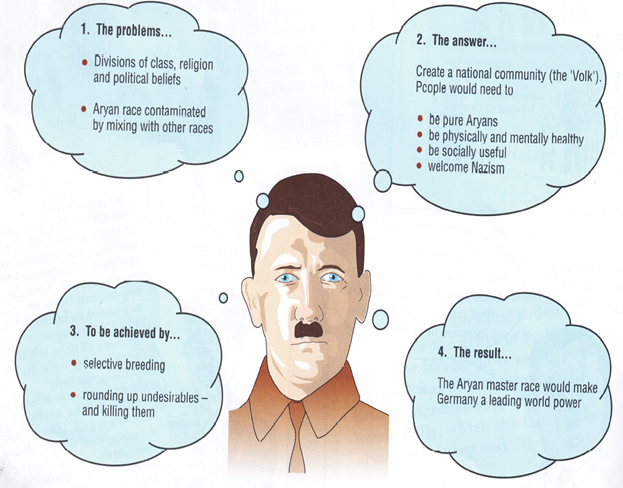

## Why did the Nazi’s persecute many groups in Germany?

* **The Master and Inferior race**
  * Hitler believed in the form of Social Darwinism where the fittest and the strongest survived and the weak and vulnerable died.
  * Hitler believed the Aryan race were the strongest and were superior due to their intelligence and capacity to work and serve the country.
  * The problem was, more than a million of these Aryans were killed in WW1 and thus creating a shortage of these men.

     
  * This made Hitler encourage all healthy men to breed healthy Aryan children.
*  **The Ideal German – Social Features**
  * The ideal German were ‘socially useful’ where they had a job and contributed to the volk.
  * Anyone else was ‘a burden to the community’, which included work - shy, the unhealthy, the disabled and mentally handicapped, tramps and beggars, alcoholics, prostitutes, homosexuals and juvenile delinquents.
  * They were seen as expensive as the cost for caring for them was increasing as the numbers grew.

