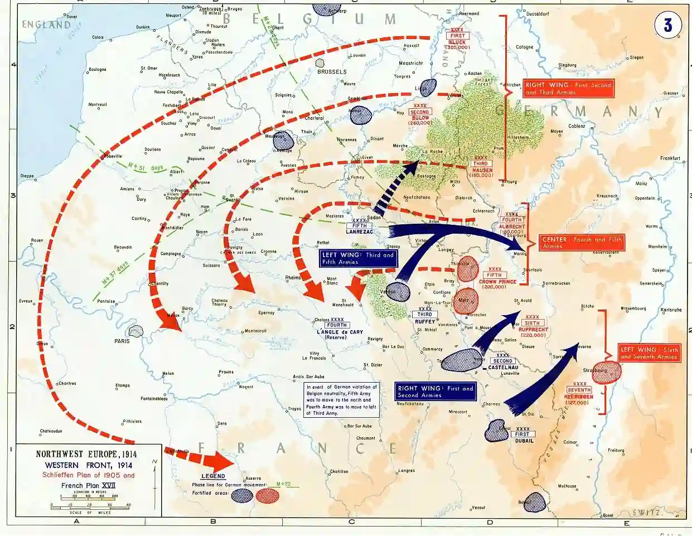

# Why was the war not over by 1914?

## How was the Schlieffen Plan intended to work?

* The plan was created by Count Alfred von Schlieffen in 1905.

* It was created because Germany wanted to avoid war on two fronts
  (France in the west and Russia in the east) at the same time.

### **How the plan was supposed to go**

The plan was to attack and defeat France before Russia could
mobilize.

* Schlieffen assumed Russia would take six weeks to mobilize.
* 10% of the German army was kept to defend against Russia on the
  Eastern front.
* 1.5 million men (90% of the army) were to move through neutral Belgium to invade France, where they were to defeat the French army and encircle Paris in 6 weeks.
* 2 divisions were sent to Alsace and Lorraine

* The plan started to go wrong when Russia mobilized in support of
  Serbia on 30th July.

### **Failure of the plan before the German invasion of Belgium**

* Changes to the plan
  * Von Schlieffen died, and the plan was altered by the new Chief of Staff (von Moltke) in 1906.
  * The creator did not implement the plan, which led to misunderstandings.
  * The German army was smaller than when the plan was made.
* The plan was outdated
  * Changed and finalized in 1906. Implemented only in 1914.
  * This didn’t account for the changes and improvements in enemy machinery and tactics.
  * Plan relied on a professionally trained army, not conscripts.
  * The plan resulted in what they wanted to avoid: a war on two fronts.