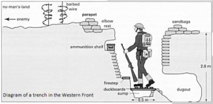

## How successful was the British Expeditionary Force (BEF)?

* The Schlieffen Plan assumed that Britain would not protect Belgium.

* Belgium asked Britain for help, and Britain sent the BEF immediately to fight the Battle of Mons (August 1914)

* Britain helped to protect themselves and their empire because if the French were defeated, the British would be next.

* The BEF was well-trained and professional, albeit small compared to the large German conscript army.

### **Battle of Mons — August 23rd, 1914**

* This was the first major battle of WW1.
* BEF was led by Sir Jon French, and the troops at Mons were led by General Douglas Haig.
* Trench warfare was not yet implemented.
* 70,000 British faced 160,000 Germans.
* BEF slowed the German army's advance, making the Schlieffen Plan impossible to achieve.
* Despite the BEF performing well, the Germans pushed the British to
  retreat south of River Marne outside Paris.

‎

* Despite this, German Chief Moltke believed the war was almost won:

  * Belgians were defeated
  * British were retreating &
  * French Plan 17 (reclaiming Alsace-Lorraine) failed.

* But when Moltke realized his forces were no longer strong enough to encircle Paris, he sent troops South-east, where the Battle of Marne was fought when they encountered the French army returning defeated from Alsace and Lorraine.

### **Battle of Marne — 5th-12th September 1914**

* Here, the BEF and French counterattacked the Germans.
* The battle lasted 5 days.
* The Germans had almost won when Parisian taxis brought in 6,000
  reserve soldiers to the front line.
* Allied troops managed to save Paris and forced the Germans to pull back to the river Aisne.
* This battle was a strategic victory for the Allies, even-though it ended in stalemate, as the Germans were pushed back to the River Aisne.