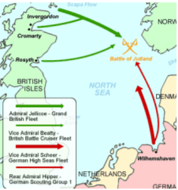

# How important were other fronts?

## Who won the War at Sea?

* Royal navy — Britain’s navy
  * It was the strongest navy in the world. Britain needed a strong navy
    to protect its empire.
  * Before 1914, Germany’s naval construction program sparked an arms
    race— with both sides building as many Dreadnoughts they could.
  * British priority was to keep open supply lines with its trading
    partners and to blockade Germany
* The German High Seas Fleet (German navy) used U-boats (submarines)
  more than their Dreadnoughts as they were too valuable.
* There were a series of minor naval battles in 1914-1915:
  * German fleet bombed Scarborough, Whitby and Hartlepool in
    December 1914
  * Battle of Heligoland Blight (august 1914), British navy bombed
    the Heligoland German naval base killing 700 people
  * Battle of Coronel (Nov 1914), Battle of Falkland Islands (Dec
    1914)

### **Battle of Jutland — 31 May - 1 June 1916**

* This was the only major sea battle during WW1.

* Britain was able to intercept the German plan as a German
  soldier with radio codes washed up on a Russian beach.

* Germany’s von Scheer wanted to tempt the British fleet from its
  base and trap them by destroying as many ships as possible. This
  would reduce their number and would end the naval blockade on
  Germany.‎

  ‎

* Since the commander of the British Fleet knew about this and
  waited at the German rendezvous point with a small fleet.

* The Germans were lured in where the rest of the British Navy was
  waiting.

* The British fleet outnumbered the German fleet.

* The naval battle lasted three days.

* Scheer sailed back to Germany when the bombing had stopped.

* But the British claimed they had won, since the Germans 'fled',
  although more British ships had been sunk.

* After 1916, the British put a naval blockade on Germany which
  caused severe food and supply shortages for the German people.

* Germany tried to blockade Britain but failed.

### **Unrestricted submarine warfare**

* At the beginning of the war Germany didn’t target: civilian ships,
  and ships from neutral nations.
* When German attempt to blockade Britain (1915) failed, Germany
  implemented a campaign of unrestricted submarine warfare — where
  Germany targeted military and civilian ships around Britain.
* This and this caused food shortages in Britain, as they imported 60%
  of their food, leading to food rationing.
* In 1917, 2.7 million tonnes of shipping were sunk by the Germans.

### **The British strategies used to counter German efforts:**

* Q ships - military boats disguised as merchant ships, lured U boats
  to surface so they were could be attacked. Could be argued if it was
  successful, as many were sunk by U boats.
* Mines - laid across the sea bed to attack German U-boats. Could be
  cleared by minesweepers.
* Convoy system- (idea by Lloyd George) Battle ships would sail in
  groups called convoys with merchant ships across the Atlantic.
* Depth charges - dropped by aircraft, would explode when they reached
  a certain depth. Didn't have to be aimed accurately as the hydraulic
  force popped rivets in U- boats.
* Unrestricted U-boat warfare pressured USA into joining the war after
  the sinking of the *Lusitania.* (British ship with Americans on
  board)