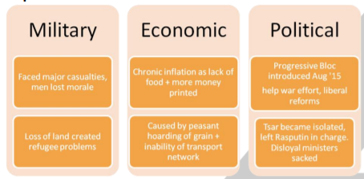

## Why did Russia leave the war in 1918?

### **Russia’s weaknesses and failures:**

* Russian commanders didn’t cooperate.
* Russian army short of rifles, ammunition and boots.
* Not well trained in modern weaponry and tactics.
* Messages not encoded, so Germans intercepted them.
* Domestic unrest in Russia leading to Russian revolution.
* Grand Duke Nikolai resigned as the Commander; the Tsar took his place.
* Major Russian defeat by the Germans by 1914.
  * Battle of Tannenberg (Aug 1914)
  * First Battle of Masurian Lakes (Sept 1914)
* Poor conditions on the front line.
* Government unable to organize the war effort effectively‎

### **Impact of the war on Russia:**

‎ 

* War reflected badly on the royal ­­family as the Tsar commanded the
  army.
* In 1917, due to the Russian Revolution Tsar Nicholas II and the
  provisional Government was overthrown by the Bolsheviks.
* The Bolsheviks signed an armistice with Germany, which withdrew Russia
  from the war (Dec 1917).
* With Russia's withdrawal from the war, Germany was able to transfer
  troops to the Western Front.
* This was an advantage for the however:
  * The British Naval Blockade caused food shortages.
  * Shortages caused German public to go against the war effort.
  * The USA joined the war in the side of the Allies

### **Treaty of Brest-Litovsk (March 1917):**

* Lost 90% of coal mines
* Lost 25% of both industry and population
* Lost Finland, Latvia, Lithuania, Estonia, Belarus and Ukraine
* Lost Turkish lands gained in Russo-Turkish war of 1877–78, to be
  returned to the Ottoman empire.