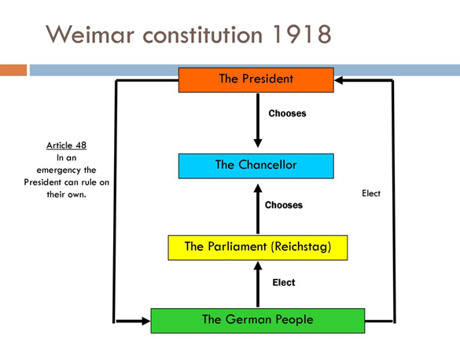

# What were the Achievements of the Weimar Republic?

## What was the Weimar Constitution?

* **Strengths:**
  * ### Established a democratic system

    Before 1919, Germany was ruled by a Kaiser (emperor). The constitution replaced this with a democracy where:

    1. The government was elected by the people

    2. Power came from citizens, not a monarch

       This was a huge step forward because it introduced **popular sovereignty** (people having power).

  * ### Universal suffrage (including women)

    One of its biggest achievements was giving the right to vote to:

    All men and women over the age of 20

    This was very advanced for the time. Many countries had not yet given women the vote, so Germany became more progressive politically.

  * ### Proportional representation

    The constitution introduced a fair voting system where:

    Seats in parliament were given based on the percentage of votes each party received

    This meant smaller parties had a chance to be represented, making the system more inclusive.
* **Weaknesses**
  * In 1919, the Republic had many enemies. Giving equal rights to those who wished to destroy it was not sensible.
  * Proportional representation encouraged many small parties, each with a small number of MPs. No one could get a majority, so governments had to be coalitions. There could never be a strong government.
  * The president had too much power. It was possible he could turn himself into a dictator.
  * The states could be hostile to the national government and even try to overthrow it.