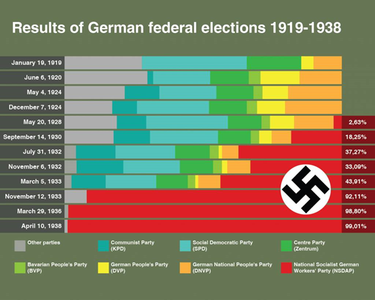

## Achievements under Stresemann

* **Foreign Policy**
  * In 1925, Germany signed the Locarno treaties with Britain, France and Italy which guaranteed Germany’s frontiers with France.
  * In 1926, Germany was allowed to join the League of Nations as permanent member.
  * These changes help strengthen ties with neighbouring countries and help improve relations
* **Local Politics**
  * During the Weimar republic, no party single handily ever got the majority, not even the Social Democrats until the Nazi Party.
  * Due to this, coalitions were formed. However, when these coalitions don’t work well, they break up resulting in multiple elections taking place
  * In total, 25 governments over the 14 years of the Weimar government
  * Many politicians complained of Stresemann’s foreign policy as he was acting in favour of following the Treaty of Versailles when many Germans wanted to completely abolish it.
* **The Economy**
  * During the Hyperinflation crisis, Germany took loans from the USA via the Dawes plan, a total of 800 million Marks to help solve the crisis, which helped and slowly the German economy improved.
  * In 1928, Industrial production surpassed the pre – WWI production levels.
  * However, the economy still had its weaknesses
    * It became dependant on American loans which could be withdrawn anytime
    * The Government was spending too much on Welfare benefits, making employers complain
    * Some industries had still not recovered such as the agriculture industry in which farmers earned half of the average national wages
    * There were extremes of wealth and poverty in Germany
* **Culture**
  * The wiemar constitution allowed free expression of ideas.

  * writers, poets, and artists flourished in this time, disregarding old styles and coming up with new and exciting ideas.

## Problems Under Stresemann

* **The Economy**

  * * It became dependant on American loans which could be withdrawn anytime
    * The Government was spending too much on Welfare benefits, making employers complain
    * Some industries had still not recovered such as the agriculture industry in which farmers earned half of the average national wages
    * There were extremes of wealth and poverty in Germany

* **Local Politics**

  * Although there was political stability in this period. The Nazis and Communists were building up their party organisations.

