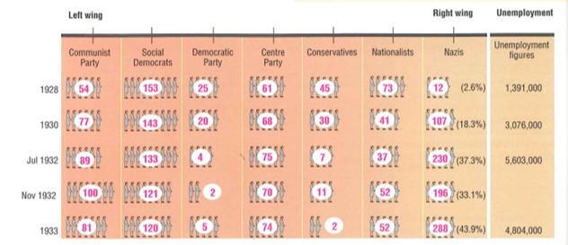

## How did the Great Depression help the Nazi’s?

* **What was life like in the depression?**
  * The depression affected different people in different ways and caused unemployment to skyrocket again. Some of the people that were affected were:
  * *Businessmen*
    * Many saw their businesses close down
    * Those that survived had a huge fall in incomes causing them to lay off their workers En Masse and the government raised taxes worsening this
  * *Young People*
    * Very few jobs were available
    * Many left school with no future prospects
  * *Farmers*
    * Crop prices fell sharply 
    * Farmers earned very little money went into debt and even lost land.
  * *Factory Workers*
    * 40% of all factory workers by 1932 were unemployed and the government moreover cut unemployment benefits to save money.
    * This caused even more unemployment

      **Why did the Depression weaken the Weimar government?**
  * *Massive unemployment and poverty*
    * By 1932, over 6 million Germans were unemployed.
    * Businesses closed, wages fell, many people struggled to survive.
  * *Failure to deal with crisis*
    * The government, led by Heinrich Brüning, made the situation worse:

      * Cut spending 

      * Raised taxes 

        This was called **deflation** and it made people even poorer.
  * *Political division*
    * Different parties in the reichstag could not agree on solutions.
    *  The Reichstag was made to look weak. The president was an 84-year-old war leader who was controlled by business and army leader and was out of his prime.
    * Since the Reichstag could not agree on anything the president had to use Heinrich had to use article 48 (emergency powers) this meant laws were passed without democracy.
  * *The Rise of extremism*
    * Due to the rise in unpopular policies and efforts, many viewed the Weimar government as ineffective and unable to do anything.
    * This persuaded them to follow extremist groups which claimed to have the power to solve all their problems like:
      * The Nazi party

      * The communist party 
    * Extremism increased and so did political violence and caused many deaths in the 1932 elections
* **How did these problems help the Nazi’s?**
  * The unpopularity caused by the Weimar republic help increase support for the Nazi’s

  * Thus, as unemployment increased, support for the Nazi’s increased and thus election by election they did better and until they became the biggest party in the Reichstag.

    

  * The Nazis success was unlike any other party and there were many reasons:

    * The party had great formal organisation
    * Their portrayed strong propaganda to the people that were moved the most
    * They gained the support of the industrialists
    * They made great use of technologies such as radio.
    * They gave great promises to voters, some of which they fulfilled
    * Hitler himself being a unique individual and a major player to their success
    * The weakness of their opposition made them even more popular