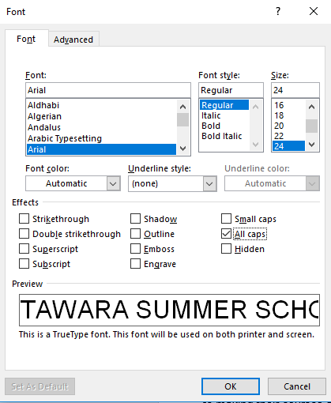

# House Styles

## House Styles

* Remember to follow all the instructions given to avoid losing easy marks
* Type in the name of the style exactly as it is in the paper
* Click on the drop-down arrow in the Styles section → select Create a new style
* Always base your styles on the Normal font
* ­Setting the line spacing → click on format → then paragraph → select
  required options
* From the same tab, you can change the spacing before and after the
  paragraph
* \
  Setting all capital letters → click on format → font → tick the option All
  Caps
* To set certain bullets to a list style → click on format → click on Numbering → Bullets tab → choose the required option
* To indent text for a style → click on format → Paragraph and input required indents under the Indentation section. Choose hanging indents to indent the whole paragraph and the first line indents to indent only the first line of a paragraph.

