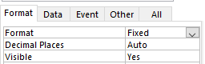
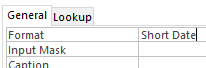
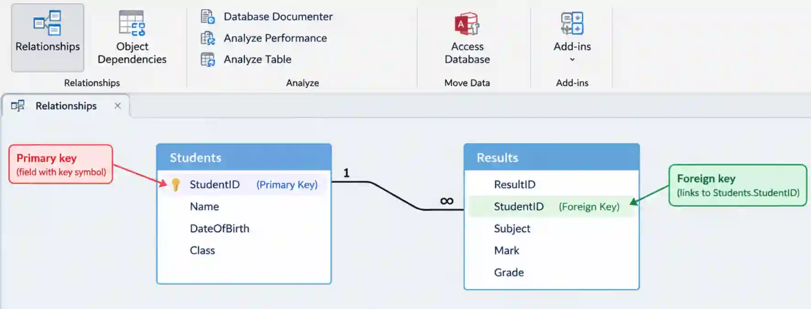
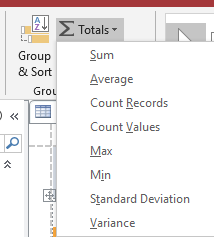

# Data Manipulation

## Data Manipulation (MS Access)

* While importing files, make sure you select the text file and not excel
  file, as .csv files are plain text.

* A delimited format refers to a way of storing data where each piece of data (also called a field) is separated by a specific character known as a delimiter.

* A CSV (Comma-Separated Values) file is a common type of delimited format where the delimiter is a comma (,).

### Steps to import a file

Step 1: Create the Database

* Open **Microsoft Access**, choose **Blank desktop database**, name it, and click **Create**.

Step 2: Import the CSV File

* Go to the **EXTERNAL DATA** tab, click **Text File**, browse to find your csv file, and choose **Import the source data into a new table**, then click **OK**.

Step 3: Use the Import Wizard

* In the Import Text Wizard, select **Delimited**, then **Comma** as the delimiter. Make sure **First Row Contains Field Names** is checked. Click **Next \>**, then go to **Advanced...**.

Step 4: Set Data Types in Advanced Settings

* In the **Import Specification**, check that all the field names and data types match those specified in the task

Step 5: Finalize the Table

* Choose **Let Access add primary key**, name the table, click **Finish**, and then **Close**.

**Tips**:

* When they ask for a set number of decimal places in a field, choose
  Fixed in Format.

  

* Ensure that the dates displayed in the table are in the correct
  format under Table Design view.     
  

* To form a relationship between two tables, go to the Relationships section of the Database Tools tab and choose the required tables.

   

* The calculations will **ONLY** work if placed in the report footer. If Σ Total is used, then it appears automatically in the report footer.

#|
||

Count the number of fields in a report

|

=COUNT(\[Primary\_field\])\<br\>Always use the primary field as it is the unique field

||
||

Sum of fields in a report

|

=SUM(\[Field\_name\])

||
||

Average of fields in a report

|

=AVG(\[Field\_name\])

||
||

Minimum of fields in a report

|

=MIN(\[Field\_name\])

||
||

Maximum of fields in a report

|

=MAX(\[Field\_name\])

||
||

Yes

|

Find values that are Yes/True

||
||

No

|

Find values that are No/False

||
||

\#01/01/2009#

|

Find a specific date

||
||

\>01/03/2009

|

Find dates after a given date

||
||

\<01/03/2009

|

Find dates before a given date

||
||

Between 01/03/2009 and 31/03/2009

|

Find dates in a given range

||
|#

