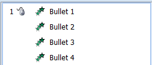
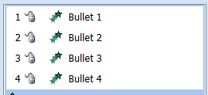
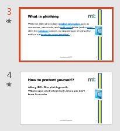
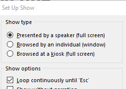
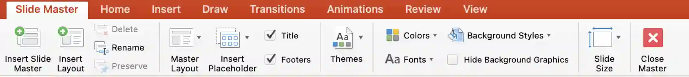

# Presentations

## Presentation Authoring (MS PowerPoint)

* To open a given outline, click the “New slide” arrow and click “slide from outline...”

* To print presenter notes, click print “Notes pages."

* To Print audience notes, click print “Handouts.”

* When printing evidence of slide transitions, go to slide sorter and
  then PrntScr

* For all bullets to enter the screen at once →, click on the Custom Animation under the Animations tab → Then select all the bullet points and Add Effect in the side pane and choose the required style.

  

* For the bullets to enter the screen one by one, → Select the first bullet point and animate as required from Add Effects. Repeat for the remaining points. 

* When printing evidence of animations, open the Custom animations
  pane and then **PrntScr**

* To show evidence of transitions, take a screenshot of the slides
  pane, having a star beside the slides that have transitions.

* It plays continuously to loop a slide show until the Esc key is pressed. Under the Slide Show tab, click on Set Up Slide Show under Set Up. It appears in the Show options section of the option box.

   

### Master slide

A master slide is a template slide that controls the universal design, fonts, colours, and background elements of every slide in the presentation. To create a master slide:

* Click the **View** tab and select **Slide Master**.

* Select the **Slide Master** at the top of the thumbnail pane to make changes that apply to the layouts based on that master.

* Edit the **fonts, colours, background, placeholders and other design elements** as required.

* The Slide Master contains different **slide layouts**. These layouts can also be edited to control the appearance and arrangement of specific types of slides.

* Close **Master View** when finished.

* Apply the required layout to individual slides as needed.

  