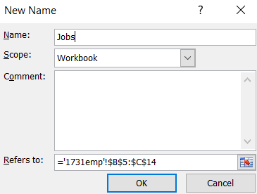
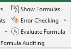
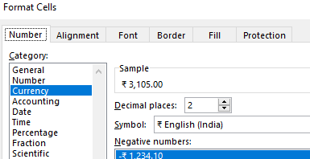
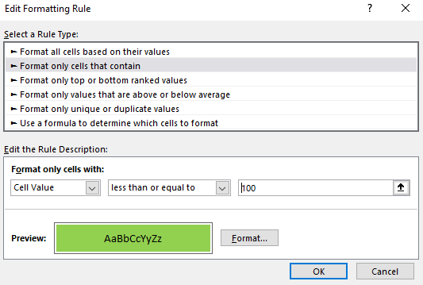
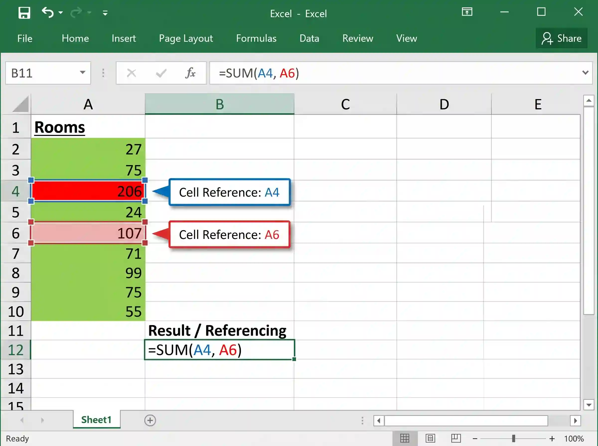

# Data Analysis

## Data Analysis (MS Excel)

* Naming a range of cells → select the cells → right click and select
  ‘Name a Range’. → type the name in the option box. Ensure the range
  is correctly selected.    
* While printing the spreadsheet:
  * check the fields required to show
  * if they want it to show formulae. (To show formulas instead of values, select Show Formulas under the Formula Auditing section of the Formulas tab.)    
* To set a cell as currency →, click on the popup box in the Number section of the Home tab → select Currency and pick the required symbol and number of decimal places as specified on the paper.    
* To colour a range of cells that contain specific values →, under the Styles section in the Home tab →, click on the drop-down menu under **Conditional Formatting**. Choose New Rule → **Format only cells that contain**. → add the rule according to the instructions on the paper from the Format tab (ego: less than 100, format: green). You can add more than one rule to a range of cells by repeating the same steps for the new rule.        
* When you are using another file as a source file (ego for a LOOKUP function), make sure it is open until the end, or else the spreadsheet will no longer be able to access that data.
  * To make a cell reference absolute, press F4 while highlighting it

|DESCRIPTION|FORMULA|
|:---|:---|
|Add, Subtract, Multiply, Divide|=A1\+B1|
|SUM = Adding a range of numbers|=SUM(A1:A4)|
|AVERAGE - Find the average|=AVERAGE(A1:A4)|
|MIN - Find the low value|=MIN(A1:A4)|
|MAX - Find the highest value|=MAX(A1:A4)|
|COUNT - Finding how many numbers are in a range|=COUNT(A1:A4)|
|COUNTA - Counting the number of items in a range|=COUNTA(A1:A4)|
|INT - Converts to the lowest whole number|=INT(A1)|
|ROUND - Rounding numbers|=ROUND(A1,2) The 2 is the number of decimal places|
|ROUNDUP - Rounding numbers up|=ROUNDUP(A1,2) The 2 is the number of decimal places|
|ROUNDDOWN - Rounding numbers down|=ROUNDDOWN(A1,2) The 2 is the number of decimal places|
|VLOOKUP - Looking up what particular values mean from a table arranged vertically|=VLOOKUP(A1,`$`B`$`1:`$`C`$`8,2)A1 is the cell to check`$`B`$`1:`$`C`$`8 is the array to look in2 is column 2 from `$`B`$`1:`$`C`$`8 meaning return the value in column 2 in that section.|
|HLOOKUP - Looking up what particular values mean from a table arranged horizontally|=HLOOKUP(A1,`$`B`$`1:`$`G`$`2,2)A1 is the cell to check`$`B`$`1:`$`G`$`2 is the array to look in2 is row 2 from `$`B`$`1:`$`G`$`2 meaning return the value in row 2 in that section.|
|SUMIF – adding up specific values in a range|=SUMIF(`$`B`$`1:`$`C`$`8,A1, `$`D`$`1:`$`D`$`8)Checks if any cells in `$`B`$`1:`$`C`$`8 = A1 and if they do then it adds them together|
|COUNTIF - Counts the number of cells in a range that satisfy the given criteria|=COUNTIF(A2:A4,"\>4") Checks that cells have a value greater than 4=COUNTIF(A2:A4, A1) Checks that the cells are equal to the value in cell A1|
|IF – Deciding what will go into a cell|=IF(`$`B`$`1:`$`B`$`8=A1,”A”)IF the value in A1 appears in the range of cells then write A|
|Nested IF|=IF(`$`B`$`1:`$`B`$`8=A1,”A”, IF(`$`B`$`1:`$`B`$`8=A2,”B”, IF(`$`B`$`1:`$`B`$`8=A3,”C”,D)))IF the value in the range equals A1 then write A, if it equals A2 write B, A3 write C and none of them D|
|Average IF – it searches for criteria and makes an average of the range according to the criteria|=AVERAGEIF(`$`D`$`4:`$`D`$`64,G3,`$`E`$`4:`$`E`$`64)`$`D`$`4:`$`D`$`64 is the range, G3 is the criteria, `$`E`$`4:`$`E`$`64 is the average range|
|SQRT – Square root of a number|=SQRT(B3)B3 is the number|
|XLOOKUP- Looks up values in a column or row and returns a corresponding value.|=XLOOKUP(A1, B1:B10, C1:C10)|
|ABS – Returns the absolute value (positive) of a number|=ABS(A1)|
