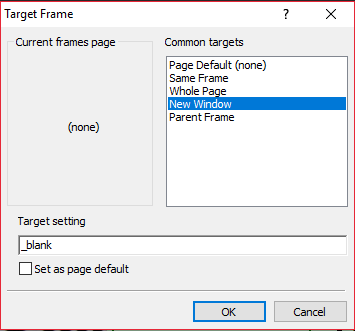

# Website Authoring

## HTML

* A webpage consists of three layers:

  * Content layer: This is the foundation of a web page, containing the main text and elements, created using HTML.

  * Presentation layer: This controls how the content looks—its layout, colors, and fonts—using CSS.

  * Behaviour layer: This adds interactivity to the page (like buttons or animations), often using scripting languages like JavaScript.

* Anchors: help navigate throughout a webpage

* Highlight the destination of the anchor, and set a bookmark

* You can use \<div\> tags in your code around this text

  `
 Destination text 
`

* Highlight the word or image that will be the hyperlink, click insert a hyperlink, and type the address of the website, the bookmark, or the email address provided in the respective places.

* If the link needs to open in a new window, select New Window from the target frame. This will give you a target setting of "\_blank."      

* If there are specified dimensions for a table, use the table
  properties to set these values.

* Check the code to ensure that the table is not set to 100% width, if
  there are other values given.

* To hide bullets from your webpage, add hidden after your tag
  selector.

|Font type|h2|
|:---|:---|
|Text size|h2|
|Aligning text|h2|
|‘Bold’ text|h2|
|‘Underline’ text|h2|
|Second choice of font|h2|
|Adding generic fonts (either serif or sans-serif)|h2 \{font-family: “Times New Roman, serif”\}h2|
|Changing colour|h2|
|Using classes to set styles. It can be used by many selectors|right|
|Comment in **HTML** - text that is not read by the computer, only for users|\<!-- Enter comment here--\>|
|Comment in **CSS** - text that is not read by the computer, only for users|/\* Enter comment here \*/|

* Colour codes have three parts:

(RED, GREEN, BLUE)

|Amount of Light (colour)|Hex code|
|:---|:---|
|Fully on|FF|
|¾ on|C0|
|½ on|80|
|¼ on|40|
|Off|00|

* **Examples:**
  * Pure red is (FF0000)
  * Pure green is (00FF00)
  * Pure blue is (0000FF)
  * Pure yellow is (FFFF00)
  * Pure black is (000000)
  * Pure white is (FFFFFF)

|HTML tag|\<html\>\</html\>|
|:---|:---|
|Opening/closing head tag|\<head\>\</head\>|
|Page title|\<title\>HTML REFERENCE\</title\>|
|Attaching a CSS file|\<link rel=“stylesheet” type=“text/css”href=“mystyle.css”\>|
|Defining anchor tag|\<a name=“top”\>\</a\>|
|Setting default target window|\<base target=“\_self”\>|
|Opening of the body/content|\<body\>\</body\>|
|Table tag \| border width as 1 \| alignment centre|\<table border=“1” align=“center”\>\</table\>|

* How to insert text:

  * \<h1\>Main Title Heading\</h1\>
    \<p\>This is a standard paragraph of body text.\</p\>

* How to insert image: 

  * \

  * **Aspect Ratio & Size:** To keep the original aspect ratio without distortion, specify **only** the `width=""` attribute or **only** the `height=""` attribute. Do not use both.

  * **Alternate Text:** The `alt=""` attribute defines the text displayed if the image fails to load.

* How to insert sound clips: To add audio tracks onto a webpage, use the `<audio>` tag. It requires a closing `</audio>` tag.

  * \<audio src="audio\_name.mp3" controls\>\</audio\>

  * **Controls Required:** The `controls` attribute must be present, otherwise the audio player interface remains hidden from the user.

* How to insert videos with controls: To add video clips that users can manually play, pause, and adjust, use the `<video>` tag with the `controls` attribute. It requires a closing `</video>` tag.

  * \<video src="video\_name.mp4" width="600" controls\>\</video\>

  * **Aspect Ratio & Size:** Use the `width=""` attribute alone to scale the video size appropriately while locking its original aspect ratio.

    * To force a video to start playing immediately on page load without showing any player interfaces or controls to the user, drop the `controls` attribute and add `autoplay muted`.

    * \<video src="video\_name.mp4" width="600" autoplay muted\>\</video\>

    * The `muted` attribute must be added alongside `autoplay` because modern web browsers block videos from playing automatically if sound is enabled