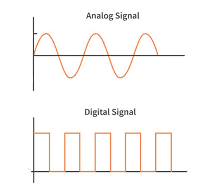

# Types and Components of Computer Systems

## Hardware & Software

### Hardware

- The electronic, physical components that make up a typical computer system. These may include input and output devices as well.
- **Internal Hardware Devices:** Internal hardware devices are the physical components located completely inside the main computer casing or system unit. They include:
  - Central processing unit
  - Processor
  - Motherboard
  - Internal memory consisting of RAM & ROM
  - Graphics & Sound Cards
  - Internal Storage devices like Hard disk drives (HDD) and solid-state drives (SSD)
  - Network interface card (NIC)
- **External Hardware Devices:** External hardware devices, also widely known as peripherals, are the physical components located outside the main computer casing. They include:
  - Monitor
  - Keyboard
  - Mouse
  - Printer
  - External Storage Devices

### Software

- The techniques, methods, commands, and instructions tell the device what to do and how to do it.
- They are the programs which control the computer system and process data.
- Relates to ideas & instructions for using physical objects.
- **Two types of software:**
  - **Application software:** Application software refers to programs that allow the user to perform specific, productive tasks or carry out distinct real-world activities not related to the running of the computer itself. These are user-chosen programs installed on top of the system software to fulfill specific industry or entertainment requirements.

    - Provides services that allow the user to do specific tasks.
    - It can be general-purpose software or custom-made software. (Specialist software)
    - Examples:
      - Word processing software: Used to create, edit, format, and print text-based documents. It allows users to manipulate text alignment, change fonts, use built-in spell-checkers and thesauruses, copy/paste content, and insert tables or images into a document.

      - Spreadsheet software: Used to organize, manipulate, and analyze numerical data arranged in a grid of rows and columns. It automates calculations using mathematical formulas  and functions. It is also used to perform "what-if" analysis and convert raw data into visual graphs and charts.

      - Database Management Systems (DBMS): Used to securely enter, store, edit, and retrieve large structured collections of data. It allows users to create tables, establish relationships between different data sets, enforce validation rules to prevent errors, and run complex "queries" to search for and filter specific records instantly.

      - Control Software: Programs designed to automatically manage a physical environment by taking data from sensors and using programming logic to send command signals to actuators.

      - Measurement Software: Programs used to monitor, observe, and record physical variables from the real world over a period of time.

      - Applets and Apps: Small applications engineered to perform a singular, highly focused task. An applet is a mini-program that runs inside a larger hosting application (like a small Java tool running within a web browser), whereas a mobile app is a standalone application downloaded directly onto a smartphone or tablet operating system to provide a specific service (like a calculator or calendar).

      - Video Editing Software: Used to manipulate, rearrange, and enhance digital video clips. It enables users to cut and splice footage together, sync external audio tracks, add transitions or titles, apply visual color grading, and export the final project into various video file formats.

      - Graphics Editing Software: Used to create, alter, or enhance digital images, digital drawings, and photographs. It allows users to work with layers, adjust brightness and contrast, crop images, airbrush anomalies out of photographs, and manipulate pixels or vector paths.

      * Audio Editing Software: Used to record, generate, and manipulate sound waves. It allows users to mix multiple audio tracks, trim audio clips, remove background static or hissing noise, adjust volume levels, and apply effects like fading in or out.

      * Computer-Aided Design (CAD) Software: Used by architects, engineers, and designers to create highly detailed, precise 2D blueprints or 3D digital models of physical structures and products. It replaces traditional manual drafting, allowing users to test a product's structural integrity, dimensions, and materials digitally before it goes into physical manufacturing.

  - **System software:** System software refers to the background programs that manage, control, and maintain the computer hardware and application software directly. Unlike application software, it does not perform tasks for the end-user. Instead, it runs behind the scenes to provide a platform for other software to run and to ensure the computer operates efficiently.

    - The software is designed to provide a platform all other applications to run on. For example:

      1. Compilers: The software translates the High-level language into Machine code (Language Processor).
      2. Linkers: A Software that creates the links between Language processors into workable solutions (Data definition language).
      3. Device drivers: A software that enables the device to work with another, externally connected device.
      4. Utilities: A system software that provides the necessary facilities (Antivirus, Scan Disk, Disk Defragmentation, etc.)
      5. Operating systems: To enable computer systems to function and allow users to communicate with computer systems, special software, known as operating systems (OS), have been developed.

### Analogue and Digital Data

Computers can only understand data in the form of binary digits (0,1); this is commonly known as digital data. However, data in the real world is analogue, not limited to two specific values.

- The figures show how data changes in analogue and digital forms; analogue data forms smooth curves, whereas digital data changes in discrete steps.
- So, for a computer to process real-world data, it first needs to convert the received data into digital form. This is done by hardware known as ADC (analogue to digital converter), and its output is given back in analogue form using DAC (digital to analogue converter).