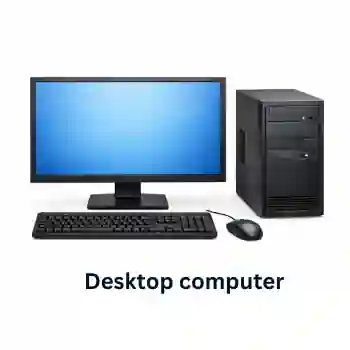
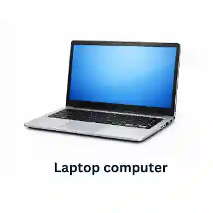
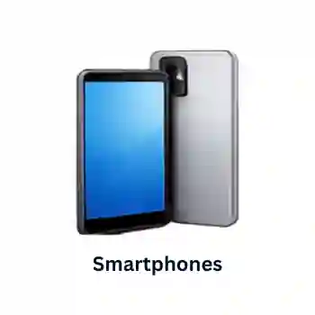
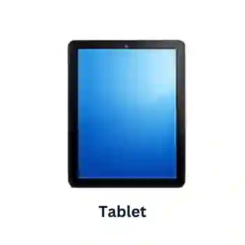
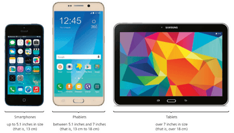

## Types of Computers

### **Desktop Computers**

* Desktop usually refers to a general-purpose computer that is made up of a separate monitor, keyboard, mouse, and processor unit. It is distinguished from, for example, a laptop computer by the fact that it is made up of several separate components, which makes it not very portable.

  

* **Uses**:

  * Office and Business Work: Desktop computers are the standard choice for offices because workers remain at a single desk for their shifts. The separate, large monitor improves ergonomics, and a full-sized physical keyboard enables fast, comfortable data entry.

  * Educational Use: Used in school computer labs because their fixed nature and separate components wired together make them difficult to steal or accidentally drop, ensuring a long operational lifespan for schools.

  * General Entertainment: Used in homes for streaming high-definition media, web browsing, and organizing files, serving as a centralized family workstation that sits in a single, permanent room.

  * Gaming Device: Highly favored by gamers because the spacious desktop casing accommodates large, high-heat graphics cards (GPUs) and specialized cooling systems necessary to run resource-heavy gaming software smoothly.

* **Advantages**:

  1. They are easier and less costly to upgrade and expand.
  2. Spare parts are standardized, which makes them cheaper.
  3. They tend to have better specifications for a given price.
  4. No critical power consumption because they plug into a wall socket.
  5. Due to fixed positions, they are less likely to be damaged or stolen.
  6. As they usually have wired connections, they have more stable internet access.

* **Disadvantages**:

  1. They are not particularly portable because they are made up of separate components.
  2. More complicated because all the components need to be hooked up by wiring, which also clutters up the desk space.
  3. Because they aren’t portable, files must be copied to another portable storage device to take work elsewhere.

### **Mobile Computers**

Mobile computers (laptops, smartphones, and tablets) can be used to send command signals over a network (Wi-Fi, Bluetooth, or mobile data networks) to control a distant physical hardware system. The mobile device runs a specialized software interface that translates user inputs into digital data packets, which are transmitted to the remote device's receiver.

### 1. Laptop computer:

* (Or notebook) refers to a type of computer where the monitor, keyboard, pointing device and processor are all together in one unit. This makes them extremely portable. lightweight (to aid portability). Low power consumption (and also long battery life). Low heat output (cooling is very important).

  

* **Uses**:

  1. Office and business work
  2. Educational use
  3. Used as a gaming device.
  4. General entertainment
  5. Real world example: An engineer using a laptop to securely log into an automated industrial factory floor from home to alter assembly-line machinery settings or shut down hardware in an emergency.

* **Advantages:**

  1. Portability: all components are in a single unit, so they can be taken anywhere.
  2. Because of one single unit, there are no trailing wires and desk clutter.
  3. take up much less room on a desk, so they can be easily used in public spaces.
  4. portability allows them to take full advantage of Wi-Fi features.

* **Disadvantages**:

  1. Portability makes it easier for them to be stolen.
  2. Limited battery life means the user needs to carry a charger at all times.
  3. Keyboards and pointing devices may be awkward to use.
  4. Not easy to upgrade, like adding more RAM.

### 2. Smartphones:

* Allow normal phone calls to be made, but also have an operating system (such as iOS, Android, or Windows), allowing them to run a number of computer applications (known as apps or applets). Smartphones communicate with the internet either by using Wi-Fi hot spots or by using 3G/4G/5G mobile phone networks.

  

* **Uses**:

  1. They allow users to send/receive emails.
  2. They allow users to use a number of apps.
  3. They allow users to use a camera feature (to take photos or videos).
  4. They allow users to use an MP3/4 player (for music and videos).
  5. Real world example: A user opening a smartphone app while at work to adjust their home smart-heating thermostat or check their home security cameras.

* **Advantages**:

  1. Very small in size and lightweight, makes them portable.
  2. Connecting to the internet while on the move.
  3. Because they use Wi-Fi and mobile phone networks, they can be used almost anywhere.
  4. They have apps which can tell instant location, which is a feature that isn’t available in either desktops or laptops.
  5. They have reasonable battery life.

* **Disadvantages**:

  1. Small screens and keyboards make pages difficult to read.
  2. More difficult and slower when typing things in.
  3. Web browsing and photography can quickly drain the battery.
  4. Memory size in most phones is not very large when compared to laptops and desktops.
  5. Not all website features are compatible with smartphone operating systems.
  6. Because of their small size, it is much easier to lose a smartphone or for it to be stolen compared to laptops or desktops.
  7. The data transfer rate using mobile phone networks can be slower than with Wi-Fi.

### 3. Tablets:

* They work similarly to a smartphone. The only main difference is that they are somewhat bigger in size as compared to a smartphone.

  

* **Uses**:

  1. They allow users to send/receive emails.
  2. They allow users to use a number of apps.
  3. They allow users to use a camera feature (to take photos or videos).
  4. They allow users to use an MP3/4 player (for music and videos).
  5. Real world example: A drone pilot using a tablet connected to a radio transmitter to view a live camera feed and steer a quadcopter flying a kilometer away.

* **Advantages of tablets compared to laptops:**

  1. Very fast to switch on (no time delay waiting for the operating system to load up).
  2. Fully portable – they are so lightweight that they can be carried anywhere.
  3. Touch screen technology means they are simple to use and don’t need any other input devices.
  4. Don’t get very hot as they use solid-state technology.
  5. The battery life of a tablet is a lot longer.
  6. When the power button is pressed, it goes into standby but remains connected to the internet so the user still hears alerts when emails or other ‘events’ are received.

* **Disadvantages of tablets compared to laptops:**

  1. Tend to be more expensive when compared to laptops.
  2. They often have limited memory/storage when compared to a laptop.
  3. Typing on a touch screen can be slow and error-prone compared to a standard keyboard.
  4. Laptops tend to support more file formats than tablets.

### 4. Phablets:

* Some of the latest smartphones have been designed as a hybrid between a tablet and a smartphone, referred to as a phablet. They have much larger screens than a smartphone but are smaller than a tablet.

* **Uses**:
  * Entertainment (streaming of music, videos, and television programs).
  * Gaming (including group games).
  * As a camera or video camera.
  * Internet use (online sales, social networks, using QR codes, and so on).
  * Sending/receiving emails.
  * Global positioning system (use of maps to navigate to a location).
  * Calendar functions.
  * Telephone banking (sending and receiving money using banking apps).
  * Voice over Internet Protocol: telephone network using the internet, which also allows video calling.
  * Instant access to social networks (social contact with friends no matter where you are in the world).
  * Instant messaging.
  * Office and business management (allows rapid voice and video communication).
  * Education use (using interactive software to teach or learn from).
  * Remotely control devices.

Note: Laptops are the most expandable of these devices, while smartphones are the most portable. Tablets and phablets fall somewhere in between, offering a balance of portability and expandability. The choice of device will depend on your specific needs and use case.