# Input & Output Devices

## Input Devices and Their Uses

* An input device is any hardware device that allows a user to enter data or instructions into a computer directly.
* An input device can send data to another device, but it cannot receive data from another device.
* Input devices are necessary for a computer to receive commands from its users and data to process; they are under the user's control or can be direct data entry.

Input devices can be complicated because they must ensure the user can interact with the computer correctly.

### **1. Keyboards:**

**Uses:**

* Input of data into applications software
* Typing in commands to the computer

**Advantages:**

* Fast entry of new text into a document.
* Well-known method.
* Easy to use for most people.
* Easier to do verification checks as data is entered (can immediately compare the source document with typed data on the screen).

**Disadvantages:**

* It can be difficult to use if the user has limited arm/wrist use.
* Slow method when compared to direct data entry.
* It is a fairly large device that uses up valuable desk space.        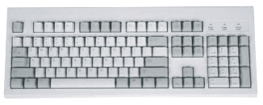

### **2. Numeric keypads:**

### **Uses:**

* Automatic teller machines (ATMs), where the customer can key in their PIN, amount of money, etc.
* Mobile phones allow phone numbers, etc., to be keyed in.
* Point of sale terminals (POS) in case the barcode reader fails to read the barcode – the number has to be keyed in manually by the operator.
* Chip and PIN devices when paying by credit/debit cards.
* Fast entry of numeric data into a spreadsheet.

**Advantages:**

* Faster than standard keyboards when entering numeric data.
* Because many are small devices, they are very easy to carry around.

**Disadvantages:**

* Sometimes, they have small keys, which can make input more difficult.
* Sometimes, the order of the numbers on the keypad is not intuitive.       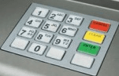

### **3. Mouse:**

**Uses:**

* Opening, closing and minimizing software
* Grouping, moving and deleting files.
* Image editing, for example, controls the size and position of a drawing pasted into a document.
* Controlling the position of a pointer on the screen to allow selection.

**Advantages:**

* It is a faster method for choosing an option than a keyboard.
* It's a very quick way of navigating through applications and the internet.
* Does not need a large desk area when compared to a keyboard.

**Disadvantages:**

* It can be more difficult for people with restricted hand/wrist movement than using a keyboard for data entry.
* Easy to damage, the older type of mouse quickly becomes clogged up with dirt.
* Difficult to use if no flat surface is readily available.       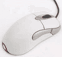

### **4. Touchpad:**

**Uses:**

* Opening, closing and minimizing software
* Grouping, moving and deleting files.
* Image editing, for example, controls the size and position of a drawing pasted into a document.
* Controlling the position of a pointer on the screen to allow selection.

**Advantages:**

* Faster than a keyboard for choosing options.
* Used to navigate applications and the internet.
* Because the touchpad is integrated into the laptop computer, there is no need for a separate mouse; this aids the portability and is a big advantage if no flat surfaces are available.

**Disadvantages:**

* People with limited hand/wrist movement find the device difficult to use.
* It can be more difficult to control the pointer when compared to a normal mouse.
* Drag and drop operations are more complicated using a touchpad.       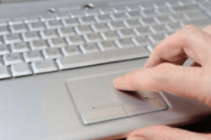

### **5. Tracker ball:**

**Uses:**

* A good alternative to a mouse for people with conditions such as RSI.
* Used in an industrial control room environment.
* Used in some luxury cars to select functions such as radio.

**Advantages:**

* Does not need the same fine control as a mouse.
* It is easier to use than a mouse if the operator has problems with their wrist.
* More accurately position the pointer on the screen.
* They are more robust than a mouse.
* Needs less desk space than a mouse or keyboard.

**Disadvantages:**

* It is not supplied with the computer as a standard; therefore, it is more costly.
* Users may need training because it is not standard equipment.       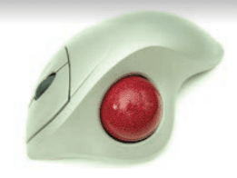

### **6. Remote Control:**

**Uses:**

* Televisions, satellite systems, DVD/Blu-ray players and Hi-Fi systems, to alter controls such as volume, on/off, etc.
* Used to control multimedia systems.
* Used in industrial applications to remotely control processes.

**Advantages:**

* It can be operated from any reasonable distance.
* In some conditions, e.g., in chemically hazardous environments, we can control and measure from safe distances.

**Disadvantages:**

* Difficult to use for people with limited hand/wrist movements.
* Physical obstacles can easily block the signal.       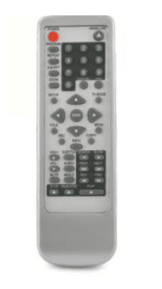

### **7. Joysticks:**

**Uses:**

* Used in video games.
* Used in simulators to mimic the actual controls.

**Advantages:**

* It is easier than keyboards for screen navigation.
* In some applications, the control is more realistic than using a mouse.

**Disadvantages:**

* The on-screen pointer is more difficult to use.       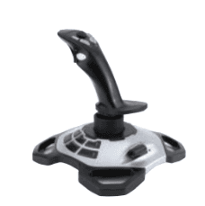

### **8. Driving wheel:**

**Uses:**

* Used in video games, especially car racing games.
* Used in simulators to mimic actual vehicle controls.

**Advantages:**

* It's a more realistic experience than both mouse and joystick.
* Easier than a keyboard or joystick to control steering movements.

**Disadvantages:**

* It is a rather expensive input device as compared to a mouse or joystick.
* Steering movements tend to be over-sensitive, which gives an unrealistic feel.
* Unless it is an expensive simulator, feedback to the steering wheel is non-existent.       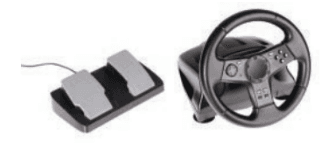

### **9. Touch screen (as an input device):**

**Uses:**

* Automatic teller machines (ATMs) to choose from on-screen options.
* Point of sale terminals such as in restaurants.
* Interactive whiteboards in education.
* Computer-based training (CBT) where answers are selected during on-screen testing.

**Advantages:**

* Faster entry of options than using a keyboard or mouse.
* Very easy method for choosing options.
* User-friendly method – no training necessary in its use.
* Option to expand the size of the display if necessary.

**Disadvantages:**

* A limited number of input options are available.
* This can lead to problems if an operator uses the system frequently (straining of arm muscles, RSI, etc., are all possible).
* The screen can get very dirty with constant touching.       

### **10. Scanners:**

**Uses:**

* Scanning documents and converting them into different formats
* Scanning in old documents to protect them in case the original is lost/damaged.
* Scanning in photographs for storage
* Scanning in barcodes at POS terminals.

**Advantages:**

* Images can be stored for editing at a later date.
* When used with OCR, they are much faster and more accurate than typing the documents in.
* It is possible to recover damaged documents by scanning and producing an acceptable copy.

**Disadvantages:**

* Limited quality, depending on how good the scanner’s resolution is.
* Fairly slow input method, especially if color mode is selected.       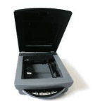

### **11. Digital Cameras:**

**Uses:**

* Taking photographs is still better than using smartphones and tablets.
* Data-capture device, e.g., as a reversing aid in cars.
* Dentistry, to help capture pictures for better diagnosis.
* The creation of virtual reality tours around houses, buildings, etc.

**Advantages:**

* Easier to produce better-quality photographs than with a traditional camera.
* Uploading photographs to a computer is faster than scanning hard copies.
* Memory cards can store many thousands of photographs.
* There is no need to develop film and printouts; it saves money and is more environmentally friendly.
* Unwanted images can quickly be deleted from a memory card.
* Higher quantity of pictures can be taken in a shorter time.
* Resolution of images is clearer compared to traditional ones.

**Disadvantages:**

* Need to be computer literate to know proper use.
* Loss of artistry due to clever software doing all the work.
* Images need to be compressed to reduce the amount of memory used.       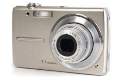

### **12. Microphones:**

**Uses:**

* To input speech to be used in various applications.
* Input in voice recognition software for authentication.
* As a sensor to pick up sound in an intruder alarm system.
* Used in audio conferencing or VoIP applications.

**Advantages:**

* It is faster to read text than it is to type it in.
* It is possible to manipulate sound in real time rather than working on a completed recording.
* It improves security if used as an authentication system.

**Disadvantages:**

* Sound files use up a lot of computer memory.
* Reading data is more error-prone than typing in.       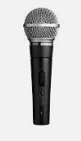

### **13. Sensors:**

**Uses:**

* Temperature sensors are used in automatic washing machines, central heating systems, ovens, and glasshouses.

  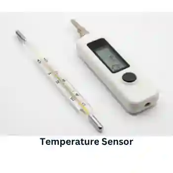
* Pressure sensors are used in intruder alarm systems and washing machines.

  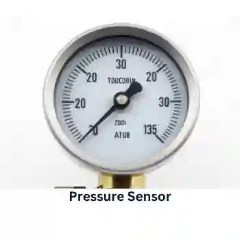
* Light sensors are used in automatic glasshouses, doors, and street lighting control.

  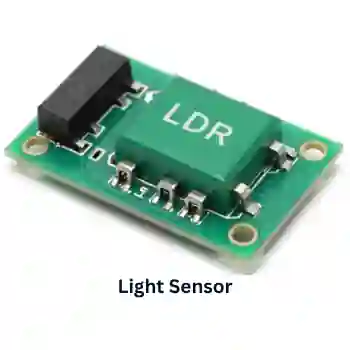
* Sound/acoustic sensors are used in intruder alarm systems, monitoring liquid and powder flow in pipes.

  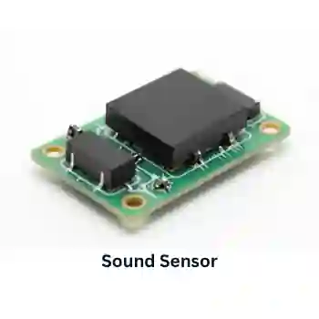
* Humidity/moisture sensors are used in automatic glasshouses, environmental monitoring, and in factories where moisture levels are crucial.

  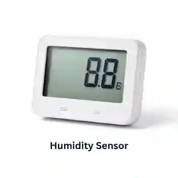
* pH sensors are used in automatic glasshouses, chemical processes and environmental monitoring.

  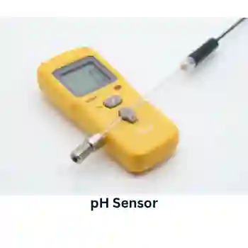

**Advantages:**

* Readings are more accurate as compared to human operators.
* Readers are continuous, with no breaks in the monitoring.
* Because it is a continuous process, any action or warnings needed will be initiated immediately.
* Automatic systems don’t need human intervention.

**Disadvantages:**

* Faulty sensors can give spurious results.
* Most sensors are analogue; therefore, they require conversion using Analogue to Digital Convertors.

### **14. Light pens:**

**Uses:**

* Selecting objects on CRT screens
* Drawing on screens

**Advantages:**

* Greater accuracy than touch screens
* Small makes them portable and capable of being used in small spaces.
* Easy-to-use technology.

**Disadvantages:**

* Lagging problems while drawing on the screen.
* It only works with CRT monitors.
* Rather outdated technology.       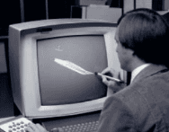