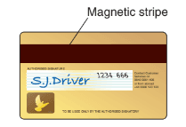
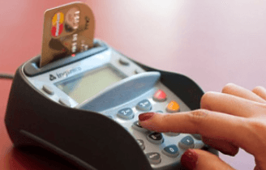
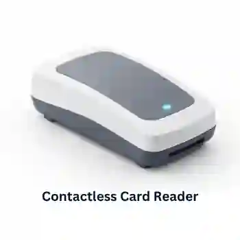
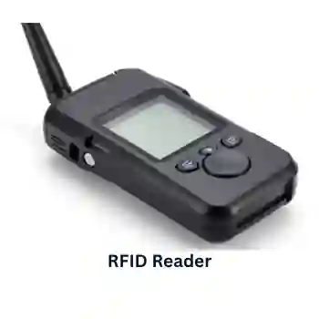
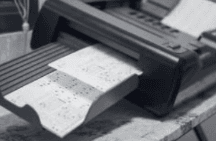
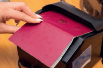
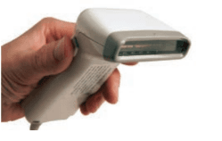
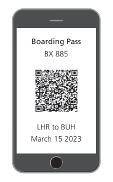

## Direct Data Entry & Associated Devices

### **1. Magnetic Stripe Readers:**

**Uses:**

* On credit/debit card for use at ATMs
* Security device to allow entry to buildings, hotels, etc.

**Advantages:**

* Faster than keying in data manually.
* Error-free, no human intervention needed.
* Secure information isn’t in human-readable form.
* Robust, there are no moving parts.

**Disadvantages:**

* If the card is damaged, the data is lost.
* Doesn’t work at a distance.
* As the information isn’t human-readable, this can be a disadvantage in some cases.   

### **2. Chip and PIN reader:**

**Uses:**

* Where payments are made using cards

**Advantages:**

* It is more secure than contactless cards as the PIN acts as a second security layer.
* More robust system than Magnetic Stripe Cards

**Disadvantages:**

* Be very careful so the PIN isn’t seen by anyone while being typed in.  

### **3. Contactless Card reader:**

**Uses:**

* To make payments, without entering the PIN number.

**Advantages:**

* People do not need to worry about typing incorrect PIN.

* Eliminates shoulder surfing.

* A easier and quicker transaction is made.

* Encryption and a unique transaction code, replaces the original card number, this increases security.

**Disadvantages:**

* There is a limit for the money transfer.

* Its is more expensive.

* It is possible that a thief can monitor and obtain details of the transaction made, by using a suitable reader.

### **4. Radio Frequency Identification (RFID) reader:**

**Uses:**

* Livestock tracking
* Retail, instead of barcodes, as they don’t need to be scanned in.
* Admission passes.
* Library books, to acknowledge the books which have been borrowed.

**Advantages:**

* No line-of-sight contact is needed.
* Very robust and reliable technology.
* Very fast read rate.
* Bidirectional data transfer.
* Bulk detection is possible.

**Disadvantages:**

* Tag collision
* As they use radio waves, they are easy to jam/interrupt.
* Easy to hack into the signal.
* RFID is more expensive than a comparable barcode system.

### **5. Optical Mark Reader/Recognition (OMR):**

**Uses:**

* Used in MCQs checking.
* Used in reading voting papers.

**Advantages:**

* Very fast way of inputting survey results.
* It is more accurate because there is no human intervention.
* More accurate than OCR methods.

**Disadvantages:**

* Designing the forms can be complicated to ensure the marks are correctly positioned.
* If there are problems, they need to be manually checked, which can be time-consuming.  

### **6. Optical Character Recognition/Reader (OCR):**

**Uses:**

* Processing passports and identity cards.
* Converting hard copy documents into electronic form.
* Used in automatic number plate recognition (ANPR) systems.
* Digitizing historic hard copies for archiving.

**Advantages:**

* It is a much faster data entry system than manual typing.
* No human intervention, its error free.

**Disadvantages:**

* System has difficulty in reading different handwritings.
* Still not a very accurate technique.  

### **7. Barcode readers:**

**Uses:**

* Used in supermarkets for stock control.
* In libraries, to keep track of books.
* As a safety function to ensure checking of electrical equipment on a daily basis.

**Advantages:**

* Much faster than manually keying in data.
* Allow automatic stock control.
* They are a tried and trusted technology.

**Disadvantages:**

* Relatively expensive system to administer.
* Not fool-proof, barcodes can be swapped between items.
* Can be more easily damaged than RFID tags or magnetic stripes.  

### **8. Quick response (QR) code scanner:**

**Uses:**

* used in advertising to contain information about the advertising company.
* Wi-Fi authentication
* Used in restaurants, you can see the menu by scanning.

**Advantages:**

* hold much more information than normal barcode.
* fewer errors than with barcodes.
* QR codes are easier to read because the cameras can even read them on a smartphone.
* It is possible to encrypt QR codes.

**Disadvantages:**

* More than one QR format is available.
* QR codes can be used to transmit malicious data.  