## Output Devices and Their Uses

### **1. Cathode ray tube (CRT) monitors:**

**Uses:**

* Their large screens allow complex diagrams to be created in Computer-aided design.
* Used with light pens to allow designs to be created.

**Advantages:**

* Can be seen at a wider range of angles, unlike LCDs.
* Allow the use of light pens.

**Disadvantages:**

* They are very heavy and bulky.
* They run very hot and can cause fires if left unattended.
* They use a lot more power than LCDs.
* Their flickering can lead to headaches.
* Image burn-in is a common issue.   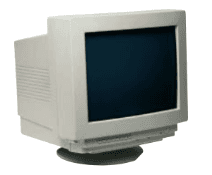

### **2. Liquid Crystal Display (LCD) screens:**

**Uses:**

* Main output device for modern computers.
* Mobile phones, laptops, video games use LCD screens.

**Advantages:**

* Very efficient, low power consumption.
* Lightweight devices.
* Screens can be made in various sizes.
* No flickering images.
* Very sharp image resolution.

**Disadvantages:**

* Colour and contrast from different angles are inconsistent.
* Motion blur is a common issue.
* Lower contrast than CRT monitors.   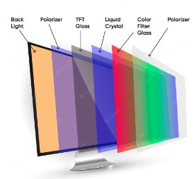

### **3. Touch screen (as an output devices):**

**Uses:**

* ATMs
* POS terminals
* Information kiosks.

**Advantages:**

* Don’t need additional input devices.
* They are very interactive, and many functions, such as swiping, can be done.
* They add a high-tech feel to devices and interfaces.

**Disadvantages:**

* They tend to get dirty with frequent use.
* Frequent use results in straining of arm muscles, RSI, etc.
* If large amounts of data are input/output, they aren’t very accurate, and the interface isn’t very fast.   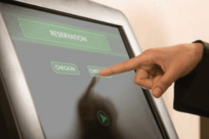

### **4. Multimedia projectors:**

**Uses:**

* Training presentations to allow the whole audience to see images.
* Advertising presentations.
* Home cinema systems.

**Advantages:**

* More people can watch as they don’t have to crowd around a laptop.
* Avoids the need for several networked computers.

**Disadvantages:**

* Images can be fuzzy.
* Expensive to buy.
* Set-up can be complicated.   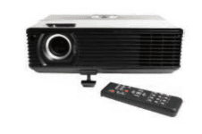

### **5. Laser printers:**

**Uses:**

* In uses where low noise is required.
* If fast, high quality, high-volume printing is required.

**Advantages:**

* Printing is fast.
* They can handle very large print jobs.
* Quality is consistently high.
* Toner cartridges last for a long time.

**Disadvantages:**

* They are only considerably fast if several copies are being made.
* Color laser printers are expensive to run.
* They produce ozone and volatile organic compounds because of their printing method and toner.   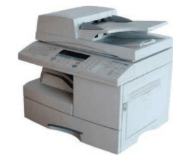

### **6. Inkjet printers:**

**Uses:**

* Where low-output volumes are required.
* Where high-quality printing is required for single pages.

**Advantages:**

* High-quality output
* Cheaper than laser printers.
* Very lightweight
* Don’t produce ozone and volatile organic compounds.

**Disadvantages:**

* Slow output if many copies are needed.
* Can’t do large print jobs.
* Printing can smudge if user isn’t careful.
* Can be expensive if used a lot.   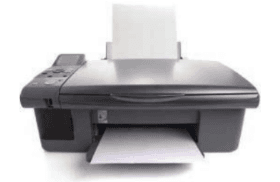

### **7. Dot matrix printers:**

**Uses:**

* Used in environments where noise isn’t a major issue.
* Carbon copies or multi-part outputs can be produced.
* Widely used in till receipts.

**Advantages:**

* Can be used in varying environments unlike laser/inkjet printers.
* Carbon copies or multi-part outputs can be produced.
* Very cheap to run and maintain.
* Good for continuous printing.

**Disadvantages:**

* Very noisy
* Initial cost is more than an inkjet printer.
* Very slow, poor-quality printing.   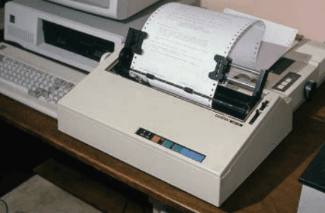

### **8. (Graph) Plotters:**

**Uses:**

* Producing architectural drawings
* Producing engineering drawings
* Drawing animation characters.

**Advantages:**

* Very high-quality output.
* can produce large, monochrome and color drawings very accurately.
* Can print on a variety on materials.

**Disadvantages:**

* Very slow printing.
* Expensive equipment to purchase initially.
* Have a very large physical footprint compared to a printer.   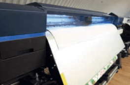

### **9. 3D printers:**

**Uses:**

* Custom-made prosthetic limbs.
* In aerospace, if parts of the aircraft are made using 3d printers they can be very lightweight.
* Making spare parts for items that aren’t now manufactured, e.g., parts of a vintage car.

**Advantages:**

* Manufacturing objects has become much easier.
* Even though the initial cost is high, it is still cheaper than the more conventional way.
* Parts for machinery that aren’t available can be made.

**Disadvantages:**

* Potential to make counterfeit items.
* Could lead to manufacture of dangerous items by almost anyone.
* Job loss potential.   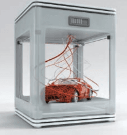

### **10. Speaker:**

**Uses:**

* Used in all phones and most computers.
* Helps visually impaired people.
* Plays downloaded sound files.

**Advantages:**

* Amplified sounds can be much louder than the original sound.
* Amplified sounds can be enough to be heard by a huge crowd.
* Very simple technology.
* They are especially useful for blind people, for instance, reading e-books.

**Disadvantages:**

* Speaker output can disturb irrelevant people in the same area, e.g., an office.
* Sound quality is high only expensive speakers.
* They take up a lot of desk space.   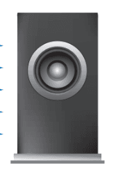

### **11. Actuators:**

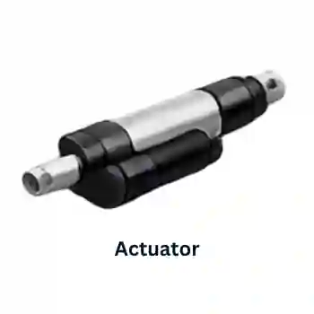

**Uses:**

* Used to turn on motors, buzzers, and switches.
* Allow a computer to control physical devices,

**Advantages:**

* Allow remote operation of many devices.
* Relatively inexpensive devices.

**Disadvantages:**

* They are an additional device in the system that could go wrong.
* As analogue devices, signals need to be converted using a DAC.