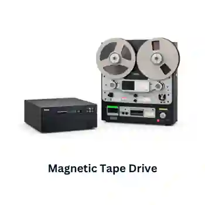
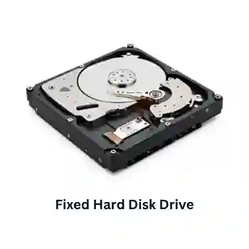
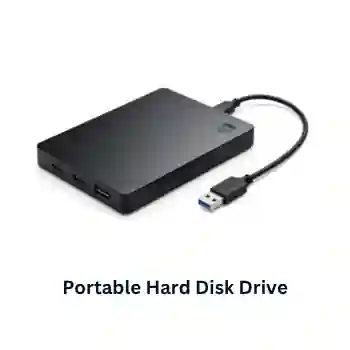

## Magnetic Backing Storage Media

**Magnetic Hard Drive (Device) vs. Magnetic Hard Disk (Media):** The hard drive is the entire sealed mechanical unit containing the spindle motor, circuit board, and read/write heads. The hard disk refers strictly to the internal circular, rigid aluminum or glass platters coated with magnetic material where the data bits are physically oriented.

* It utilizes a magnetizable coating (like iron oxide) on spinning platters or long plastic ribbons. 

* Data is written by an electromagnetic head altering the magnetic polarity of spots on the surface. 

* It uses direct/random access for hard disks (heads move instantly to any data sector) and serial/sequential access for magnetic tapes (the device must physically wind through all preceding data in order). 

* Typical capacities range from 1TB to 8TB\+ for hard disks, and up to 18TB\+ for tape cartridges.

### **Magnetic tape drives**

**Uses:**

* used in applications where batch processing is used.
* used as a backup media where vast amounts of data need to be stored.
* used in long-term archiving of data, they have huge data storage capacities and are known to be very stable.

**Advantages:**

* They are generally less expensive than hard disk drives.
* It is a very robust technology.
* They have a huge data storage capacity.
* The data transfer rate is fast.

**Disadvantages:**

* Prolonged data access times (uses serial access).
* When updating, another tape is needed to store the final updated version.
* They are affected by magnetic fields, a strong field can corrupt data stored on the tape.

### **Fixed Hard Disks/Drives**

**Uses:**

* To store the OS, systems software and working data/files.
* Storing applications files.
* Used in real-time systems and in online systems.
* Used in file servers for computer networks.

**Advantages:**

* They have a very fast data transfer rate and fast access times to data.
* They have a very large memory capacity.

**Disadvantages:**

* It can be fairly easily damaged.
* They have many moving parts which affect overall reliability.
* Their read/write operation can be quite noisy when compared to solid-state drives.

### **Portable Hard Disk Drives**

**Uses:**

* Can be used as a backup system to prevent data loss.
* It can be used to transfer data/files/software between computers.

**Advantages:**

* Data access time and data transfer rate are very fast.
* It has a very large memory capacity.
* It can be used as a method of transferring information between computers.

**Disadvantages:**

* They can be easily damaged if user accidentally drops it or doesn’t correctly shut down the drive after use.
* The data transfer rate is not as fast as for fixed hard disk drives.