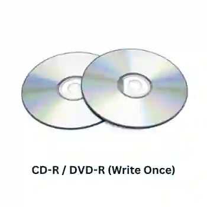
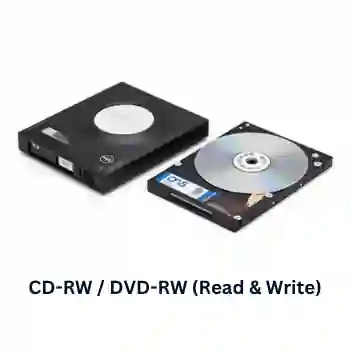
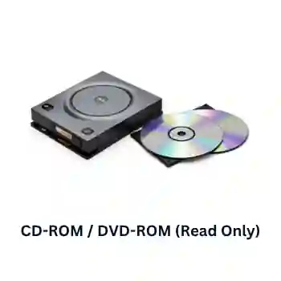
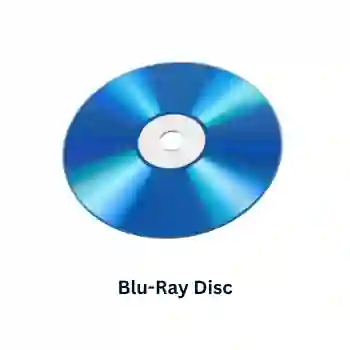

## Optical Media and Optical Storage Devices

**Optical Drive (Device) vs. Optical Disc (Media):** The optical drive is the physical hardware slot containing the motor to spin the disc and the laser diode assembly that projects light. The optical disc is the removable, circular plastic platter itself (the CD, DVD, or Blu-ray) that contains the physical lands and pits.

* It consists of poly-carbonate plastic discs containing a single continuous spiral track.

*  Data is read by shining a low-powered laser diode over the surface; flat, reflective areas (**lands**) reflect light straight back to a sensor (binary $1$), while burned indentations (pits) scatter the light (binary $0$).

*  It utilizes direct/random access to find data sectors. 

* Typical capacities are \~700MB for CDs, 4.7GB to 8.5GB for DVDs, and 25GB to 50GB\+ for Blu-ray.

### **CD-R/DVD-R \~ Write Once Only**

**Uses:**

* Home recordings of music and (CD-R) and films (DVD-R).
* Used to store data to be kept for later use or transferred to another computer.

**Advantages:**

* Cheaper medium than RW disks.
* Once burned (and finalised), they behave like a ROM.

**Disadvantages:**

* It can only be recorded once; if an error occurs, then the disk has to be thrown away.
* Not all CD/DVD players can read CD-R/DVD-R.

### **CD-RW/DVD-RW \~ Read and Write**

**Uses:**

* Used to record television programs which can be recorded over, time and time again.
* Used in CCTV systems.
* It can be used as a backup device for files and data.

**Advantages:**

* It can be written over many times.
* You can use different file formats each time it is used.
* It is not as wasteful as the R format because the files/data can be added later.

**Disadvantages:**

* It can be relatively expensive media.
* Possible to accidentally overwrite data.

### **CD-ROM/DVD-ROM \~ Read Only Memory**

**Uses:**

* These are read-only memory (ROM), which means they can’t be written over and can only be read. Permanent storage method.
* CD-ROM is used to store music files and to store software, computer games and reference software.
* DVD-ROM has much larger storage and is used to store films.
* Used in applications where there is a real need to prevent deletion or overwriting of important data.

**Advantages:**

* They are less expensive than hard disk drive systems.
* They are very portable as they are small and light.
* Data stored on them is read-only, so it cannot be accidentally overwritten.

**Disadvantages:**

* Hold far less data than hard disk drives or memory sticks.
* Very slow data transfer rate and data access times, as compared to hard disk drives.
* You cannot add your files to the disks because they are both read-only.

### **Blu-Ray Discs**

The main differences between DVD and Blu-ray are:

1. Blu-ray uses a blue laser rather than a red laser. (The wavelength of blue light is 405nm, much smaller than the 650nm red laser) This makes pits and lands much smaller, so they store five times more data than DVDs.
2. Blu-ray disks automatically come with a secure encryption system, which helps to prevent piracy and copyright infringement.
3. The data transfer rate for a DVD is 10 Mbps, and for a Blu-ray disc, it is 36 Mbps.

**Uses:**

* Home video consoles.
* Storing and playing back movies.
* Computers can use this technology for data storage or backing hard drives.
* Camcorders can use this media to store movies.

**Advantages:**

* Very large storage capacity.
* Very fast data transfer rate.
* The data access speed is also greater than with other optical media.
* Blu-ray discs automatically come with a secure encryption system.

**Disadvantages:**

* Relatively expensive discs.
* Encryption problems when used to store videos.
* The introduction of HD (high definition) DVD players has reduced the advantages of using Blu-ray technology.