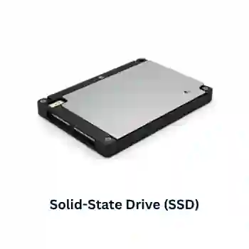
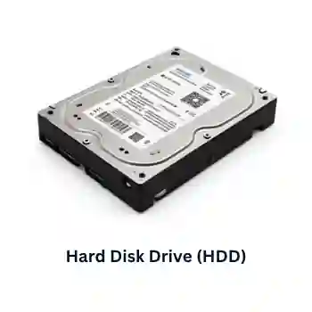
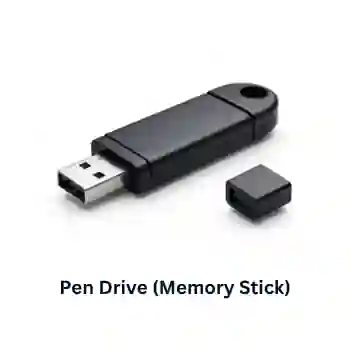
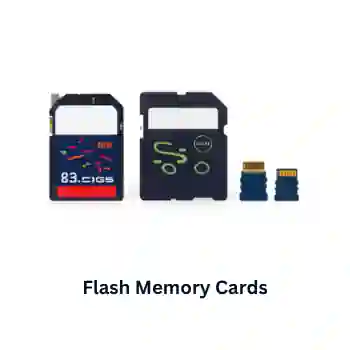

## Solid State Backing Storage

* It contains completely zero moving or mechanical parts, storing data entirely electronically using arrays of floating-gate transistors on silicon microchips (NAND flash memory).
* It traps or releases electrical charges to switch states between $0$ and $1$.
* It utilizes direct/random access, retrieving data almost instantaneously via electrical circuits.
* Typical capacities range from 32GB to 512GB for memory cards, and 250GB to 4TB\+ for solid-state drives.

### **Solid-state drives (SSD)**

**Uses:**

* Storage device to store files, applications, OSs, and so on.

**Advantages:**

* They are more reliable as they have no moving parts.
* They are considerably lighter and suitable for laptops.
* They do not have to ‘get up to speed’ before they work correctly.
* They have lower power consumption.
* They run much cooler than HDDs.
* Because they have no moving parts, they are very thin.
* SSD data access time is only 0.1 milliseconds compared to 10 milliseconds for HDD.
* Data transfer speed for SSDs is also much faster than for HDDs.

**Disadvantages:**

* SSD endurance - SSDs are conservatively rated at only 20GB write operations per day over three years.
* More expensive than magnetic hard disks.
* Smaller storage capacity than magnetic hard disks.

### **Hard Disk Drives (HDD)**

**Uses:**

* Storage device to store files, applications, operating systems, and backups.

**Advantages**

* Generally offers larger stroage capacities than SSDs.

* More affordable compared to SSDs.

* Well-suited for long-term storage needs.

* Reliable for non-intensive read/write operations.

**Disadvantages**

* Have moving parts, making them more prone to damage.

* Heavier and bulkier compared to SSDs.

* Higher power consumption.

* Slower data transfer and access speeds compared to SSDs.

* Generates more heat and noise.

### **Pen drives (Memory sticks)**

Extremely small, pocket-sized flash memory devices that plug directly into a standard USB port, designed primarily for basic file transport, convenience, and low-cost portability.

**Uses:**

* Transporting files between computers or using them as a backing store.
* Used as a security device to prevent software piracy (known as a dongle).

**Advantages:**

* Very compact and portable media.
* Very robust.
* Does not need additional software to work on most computers.
* They are not affected by magnetic fields.

**Disadvantages:**

* Cannot protect the data/files by making it ‘read-only’.
* Easy to lose (due to the small physical size).
* The user needs to be very careful when removing a memory stick from a computer - incorrect removal will corrupt the data on the memory stick and make it useless.

### **Flash Memory cards**

* A separate class of portable solid-state storage. 

* They consist of full-scale internal SSD components housed inside a protective external casing, connecting via ultra-high-speed interfaces (like USB-C). 

* They offer much larger storage capacities (1TB to 4TB\+) and significantly faster data transfer rates than standard pen drives, making them capable of backing up entire computer systems or editing high-definition video directly from the drive.

**Different types of memory cards:**

* SD cards (secure digital card; widely used in portable devices).

* XD cards (extreme digital card; mainly found in older digital cameras).

* CFast card (compact, fast card; designed for high-speed data transfer in professional cameras).

**Uses:**

* Storing photos on digital cameras.
* Used as mobile phone memory cards.
* Used in MP3 players to store music files.
* Used as a backing store in hand-held computer devices.

**Advantages:**

* Very compact.
* Because they have no moving parts, they are very durable.
* They can hold large amounts of data.
* Compact cameras and smartphones can read and write memory cards, allowing users to transport extensive collections of photographs, songs, etc.

**Disadvantages:**

* Expensive per gigabyte of memory when compared to HDDs.
* Have a lower storage capacity than hard disks.
* Have a finite life regarding the number of times they can be read from or written to.
* Memory cards, specifically the micro SD card, are the smallest sized devices available, making them more likely to be lost, stolen or damaged. The storage should be sized cause the amount of storage does not prevent the drive from being stolen
* Users must often purchase a card reader or USB converter to view the data.