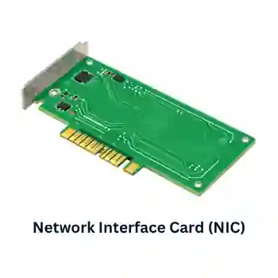
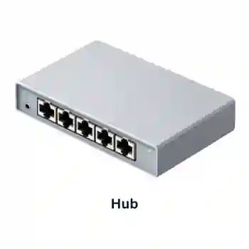
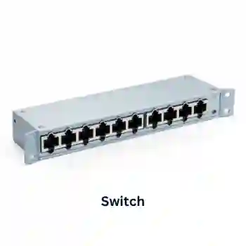
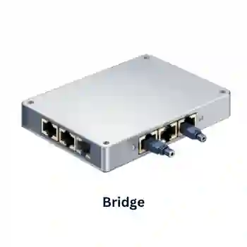

# Networks & the Effects of Using Them

## Networks

**IP and MAC address**

An IP address (Internet Protocol address) is a unique number assigned to a device on a network.

* IPv4 is a 32-bit address (e.g., 192.168.1.1)

* IPv6 is a newer 128-bit address that allows many more unique addresses (e.g., 2001:0db8:85a3:0000:0000:8a2e:0370:7334)

A MAC address (Media Access Control address) is a unique identifier assigned to a network interface card (NIC). It is a hardware address and doesn’t change, unlike an IP address.

**Routers**

A device that enables data to be sent between *different types of networks*. It can be connected through cables or wirelessly to connect a LAN to the internet.

It can be used for:

* connecting networks and devices to the internet,
* storing computer addresses,
* routing data packets.

When a data packet is received, the router checks if the packet is intended for it or another network. The data packet is routed to the local switch/hub if it's meant for its network. If not, the data packet is sent to the relevant router, which sends it to the relevant device.

* They consult routing tables to know where to send the data.
* A **WAN** (Wide Area Network) covers a large geographical area, like the internet.
* A **WLAN** (Wireless Local Area Network) connects devices wirelessly within a small area like a building.

**Data Packets**

A data packet is a small chunk of data sent over a network. It contains both the actual data and control information, such as the destination address, source address, and error checking bits.

### **Common Network Devices**

1. **Network Interface Cards (NIC):** These are needed to allow a device to connect to a network. Turns binary data into an electrical signal that allows network access. Usually integrated into the motherboard.

   

* Each NIC is given a unique hardwired media access control (MAC) address.

  Media access control (MAC) address: a number that uniquely identifies a device when connected to a network.

* The first six hex digits identify the manufacturer’s code, and the next 6 identify the device’s serial number.

2. **Hubs:** they are hardware devices that can have several other devices connected to them. They are used to connect devices together to form a local area network (LAN). It takes a data packet received by one of its ports and sends it to all relevant or irrelevant devices that are connected to it.

   

* It is not very secure to broadcast data to all devices.
* Unnecessary network traffic.

3. **Switches:** intelligent hubs. Used to connect devices to form a LAN. Unlike hubs, the switches store the MAC addresses of all devices on a lookup table. So, it only sends data to the relevant device.

   

   In summary:

* Both are used to connect devices in LAN.
* Both use data packets.
* Hubs send data to every device on the network.
* Switches send data to a relevant device only.
* Switches have better security.
* Switches use lookup tables to determine the destination for a data packet.
* Switches use MAC addresses for relevant device locations.

4. **Bridges:** Devices that connect one LAN to another LAN that use the same protocol. Unlike routers, they can’t communicate with external networks, such as the Internet.

   

   Comparison:

* Bridges connect LANs together; routers connect various types of networks together.
* Bridges scan MAC addresses while routers scan the IP addresses.
* Both send out data in the form of data packets.
* Bridges connect networks with the same protocol; routers can connect networks with different protocols.
* The router uses routing tables to direct data packets, but bridges don’t.
* Bridges have only two ports; routers have multiple ports.

### **Wi-Fi & Bluetooth**

Both are used for wireless communication between devices. They both use electromagnetic radiation as the carrier of data transmission.

**Bluetooth uses:**

* When transferring data between 2 or more devices that are very close together.
* When the speed of data transmission isn’t crucial.
* For low-bandwidth applications.

**Wi-Fi uses:**

* Full-scale networks.
* When the data transfer rate is crucial.
* For uses where a higher range and better security are required.

Differences and similarities:

* Bluetooth uses a transmission frequency of 2.4 GHz, whereas Wi-Fi uses a 2.4 – 5.0 GHz range.
* Wi-Fi has a much faster data transfer rate.
* Wi-Fi has a higher geographical range in which it is effective.
* Bluetooth only allows up to 7 devices to be connected simultaneously, whereas the number of devices connected to a Wi-Fi network depends on the router/routers used.
* Bluetooth uses key-matching encryption. However, Wi-Fi uses WPA (Wi-Fi protected access) and WEP (wireless equivalent privacy).

**Connecting a device to a network using Wi-Fi and Bluetooth**

#### Step-by-Step Procedure to Connect via Wi-Fi:

1. **Enable the Wi-Fi Hardware:** Access the device’s system settings and toggle the Wi-Fi radio antenna to the "On" position.

2. **Broadcast and Scan:** The device automatically scans the local area for wireless radio frequencies broadcasting an SSID (Service Set Identifier/Network Name) from local Wireless Access Points (WAPs).

3. **Select the Network:** The user selects the specific SSID network name from the generated on-screen list.

4. **Authentication & Encryption:** If the network is secured, the user is prompted to type in the security wireless passcode. The network router verifies this passcode using security encryption protocols like WPA (Wi-Fi Protected Access) or WEP (Wired Equivalent Privacy).

5. **IP Assignment:** Once authenticated, the network's router assigns a unique temporary IP address to the device, establishing a live connection to transmit data packets.

#### Step-by-Step Procedure to Connect via Bluetooth:

1. **Enable Bluetooth:** Turn on the Bluetooth radio setting on both participating devices.

2. **Make Discoverable:** Set at least one device to "Discoverable Mode" so it broadcasts its wireless hardware presence to other nearby devices.

3. **Scan and Select:** Initiate a scan on the primary device, view the list of local discovered hardware, and select the name of the secondary device.

4. **Pairing and Passkey Matching:** The devices initiate a secure handshake by displaying an identical numeric PIN or passkey code on both screens. The user must confirm that the keys match on both devices.

5. **Establish Connection:** Once confirmed, a short-range, peer-to-peer connection is finalized, allowing low-bandwidth wireless communication to begin.

### **Cloud Computing**

This method is where data is stored on remote servers accessed online.

The three types of cloud storage are:

1. Public Cloud - The customer and the cloud storage provider are different companies.
2. Private Cloud - The customer and the cloud storage provider are a single organization.
3. Hybrid Cloud - Combines public and private cloud options and allows sensitive data to remain private while providing public cloud services for less sensitive information.

* Cloud data is duplicated and stored on other servers to ensure availability during system failures, upgrades, and maintenance.

**Advantages:**

* Services can be scaled up or down according to changing requirements.
* Cloud storage eliminates the need for a business to purchase expensive equipment for infrastructure and maintenance.
* Readily available globally, allowing both remote working and data sharing.
* Providers offer high levels of ensuring that services are always available.
* It can offer an almost unlimited amount of storage.
* A backup of the data from the cloud will allow full data recovery in case of incidents.
* Files can be synced across multiple devices.
* There is no need to carry storage devices around.

**Disadvantages:**

* A stable internet connection is always required.
* Data storage in clouds may be vulnerable to security breaches.
* The user depends on the storage provider for reliability and availability of services.
* The services may become expensive as the amount of storage or bandwidth required increases.

### **Common Network Environments**

### **Internet**

* The **Internet** is a very large global network that consists of many other **interconnected** networks

* The **World Wide Web** is a vast collection of web pages that can be accessed using a web browser.

* The **World Wide Web** allows you to access information by using the internet

Characteristics:

* It is an open network, meaning everyone can access the same resources and information as everybody else.
* People from all over the world can communicate with each other in real-time.
* Available to anyone who has a suitable device and access to any one of the interconnected networks.

Uses:

* Education and training
* Social Networking
* Online shopping
* Entertainment

### **Intranet**

* Usually private and are used to send information securely and safely.
* Access to an organization’s Intranet is restricted and only accessible to authorized users such as employees.
* Intranets have many advantages over the internet, such as:
  * Better bandwidth than the internet,
  * Data is kept within the organization,
  * Less chance of hacking and attacks,
  * Administrators can manage access to external sites and links.

Characteristics:

* A private network that is accessible to employees within a company or organization.
* Usually behind a firewall to ensure security.
* Allows for document sharing and the use of collaboration tools between users.
* It can be customized to meet the specific requirements of the business.
* Users will require a username and password to access the Intranet.

### **Extranet**

* Private Intranet that also allows access by selected parties that reside outside of the organization. These parties, for example, maybe customers, key stakeholders or clients.
* Users will have an authorization level once they have successfully logged in, which will determine which resources they may access.

Similarities between the Internet, Intranet and Extranet are as follows:

* They are all web-based technologies
* They allow users to access information remotely
* They all use client-server architecture
* They all use security measures such as authentication and encryption
* They all promote and facilitate information and resource sharing

Differences between the Internet, Intranet and Extranet are as follows:

* The internet is a global network, whereas an intranet/extranet is a private network contained within an organization
* The use of the internet covers a wide range of purposes, whereas an intranet/extranet is designed for specific users and purposes.
* Much information is publicly available, whereas an intranet/extranet is not.
* The Internet is not owned solely by one person or organization, whereas the organization usually owns intranets/extranets.

### **Network Types**

1. **Local Area Network (LAN):** networks usually contained within a single building or small geographical location. It is made up of hubs and/or switches, which will connect several devices together. One hub or switch commonly connects to a router, allowing LAN connectivity to other outside networks such as the Internet.

**Advantages:**

* Allows centralized management of updates, backups and software installations.
* Can secure its devices with the use of **firewalls**, antivirus software and other security features to prevent unauthorized access.
* A LAN allows users on the network to share resources such as printers and other peripherals.

**Disadvantages:**

* The network may not function correctly in case of hardware failure.
* They are more prone to attacks than standalone computers.
* Data and peripheral accessing can be slow, based on network traffic.
* LAN networks require maintenance to ensure the software is up-to-date.

2. **Wireless Local Area Network (WLAN):** Local Area Networks allow devices to connect wirelessly rather than using physical cables. Wireless Access Points (WAPs) are connected to an existing wired network, which provides wireless connectivity. Support a vast range of devices, such as smartphones and laptops, are very popular in public areas such as shopping malls.

**Advantages:**

* Allows users to connect anywhere in the range of a Wireless Access Point (WAP).
* They can be used in various indoor and outdoor environments, making them highly flexible.
* As the requirements change, additional WAPs can be added relatively easily.
* Printer access can be given to wireless devices.

**Disadvantages:**

* The strength of their signals can be affected by obstacles such as walls.
* Speeds can be affected by high-traffic areas.
* It can sustain interference from other devices which can affect performance and connectivity.
* Can be vulnerable to security threats due to signal interception.

  

3. **Wide Area Networks (WAN):** is formed by several LANs connected through a router. It is expensive. However, it comes with a more enhanced security. Additional hardware is needed for a WAN: Routers, modems, and proxy servers.

**Advantages:**

* Provide the ability to connect geographically dispersed locations, such as offices in different cities or countries.
* Offer the flexibility to scale up or down based on the organisation's needs.
* Administrators can monitor and manage the network infrastructure from a single location.

**Disadvantages:**

* Setting up and maintaining a WAN can be expensive, especially compared to LANs.
* Cover larger distances and rely on public networks or leased lines, which can introduce latency and affect performance.
* WANs are subject to the reliability and availability of external service providers.

  

### Differences between LAN, WLAN and WAN

#|
||

**Feature**

|

**LAN**

|

**WLAN**

|

**WAN**

||
||

Geographical Area

|

Small local area (e.g., a single building, school, or office).

|

Small local area (same as LAN, but without physical wires).

|

Large global area (e.g., across cities, countries, or continents).

||
||

Connection Medium

|

Physical cables (Ethernet, copper twist, or fiber-optic).

|

Wireless signals (Radio waves / Wi-Fi).

|

External telecom infrastructure (Satellites, undersea cables, phone lines).

||
||

Data Transfer Speed

|

Very high speeds (typically 1 Gbps to 10 Gbps).

|

Slower than wired LAN due to distance from router and interference.

|

Slower data transfer rates over massive distances.

||
||

Security

|

High security (physically secure; hackers need physical access to plug into cables).

|

Lower security (signals can be intercepted; requires strong encryption/passwords)

|

Vulnerable to security risks (data travels across public infrastructure).

||
||

Ownership

|

Privately owned by the organization or individual using it.

|

Privately owned (same as LAN, but requires a Wireless Access Point).

|

Leased/Shared infrastructure from telecom companies

||
||

Cost

|

Relatively cheap setup (cables and switches are inexpensive).

|

Cheap setup, but high-quality routers/access points can add to costs.

|

Very expensive to set up and maintain due to leased lines.

||
||

Main Example

|

A school computer lab or a corporate office network.

|

A home Wi-Fi network or a coffee shop hotspot.

|

The Internet or a global bank's ATM network.

||
|#

