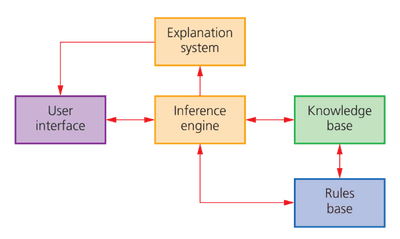

## Expert Systems

It is an AI-based computer program that emulates the decision-making capabilities of human experts. It uses knowledge and rules to provide accurate advice or solutions in a specific domain.

Examples include:

* Diagnostics: identifying a problem using tests (Blood test for illness, car scan for faults, dental check for cavities…)
* Mineral prospecting
* Tax and financial calculations
* Strategy games
* Identification of plants, animals and chemical compounds
* Route scheduling for delivery vehicles
* Car engine fault diagnosis
* Medical financial planning

**Components of an Expert System**

**1. User Interface**

* This is the only thing that the end user sees
* Allows the user to interact with the system
* Often requires training to operate effectively

**2. Explanation system**

* Informs the user of the reasoning behind the expert system’s conclusions
* It will supply a conclusion and any suggested actions to take
* It will also give the percentage probability of the accuracy of its conclusions

**3. Inference engine**

* The main processing element of the system
* It acts like a search engine examining the knowledge base
* Responsible for gathering information
* This is the problem-solving part of the system
* Attempts to use information gathered from the user to find a matching object

**4. Knowledge base**

* It is a repository of facts
* stores all the knowledge about an area of expertise
* a collection of objects and their attributes

**5. Rules base**

* The rules base is a set of inference rules.
* Used by the inference engine to draw conclusions
* They follow logical thinking

### **How an expert system is used to produce possible solutions**

Below is an example of how an expert system works to diagnose a medical issue:

* The interactive screen asks questions for the doctor to answer using a keyboard or a touch screen.
* The inference engine compares the symptoms with the knowledge base, using the rule base to find matches.
* The system suggests the possible illness with a probability of each, cures, and recommendations on the next step.
* The explanation system will explain how that particular diagnosis was suggested.