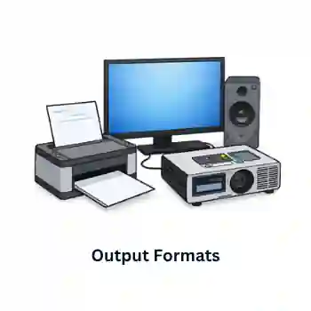

## Design

Once the analysis has taken place and the systems analyst has some idea of the scale of the problem and what needs to be done, the next stage is to design the critical parts of the recommended system.

### **File/Data Structures**

* Field length: number of characters allowed in a field
* Field name: an identifier for the field in the data structure
* Data type: specifies the kind of data that can be stored in a field, e.g., text, numbers, dates
* Coding of data: using codes to represent data, e.g. M for male, F for female

### **Input Formats**

* **Data capture forms**: These are designed to collect data from users in a structured format. They come in two types: paper-based and electronic-based. Paper-based data-capturing forms must be carefully designed with headings, concise instructions, character and information fields, checkboxes, and enough writing space. Text boxes, on-screen help, drop-down menus, radio buttons, automatic validation, and control buttons for data entry are all features of computer-based forms.

  Consider a user-friendly layout, clear instructions, and appropriate data fields.

  

### **Output Formats**

* **Screen layouts:** how information is presented to users on a screen
* **Report layouts:** how information is organized in a printed or digital report
* Consider readability, visual appeal, and efficient use of space

  

### **Validation Routines**

It is a method of examining data submitted to a computer to determine if it meets specific requirements. It is a routine check that the computer does as part of its programming.

**1. Range check:** ensures data is within a specified range of values

**2. Character check:** ensures data contains only allowed characters

**3. Length check:** ensures data is of a specified length

**4. Type check:** ensures data is of the correct data type

**5. Format check:** ensures data conforms to a specific format

**6. Presence check:** ensures data is present and not left blank

**7. Check digit:** a digit added to a number to verify its accuracy