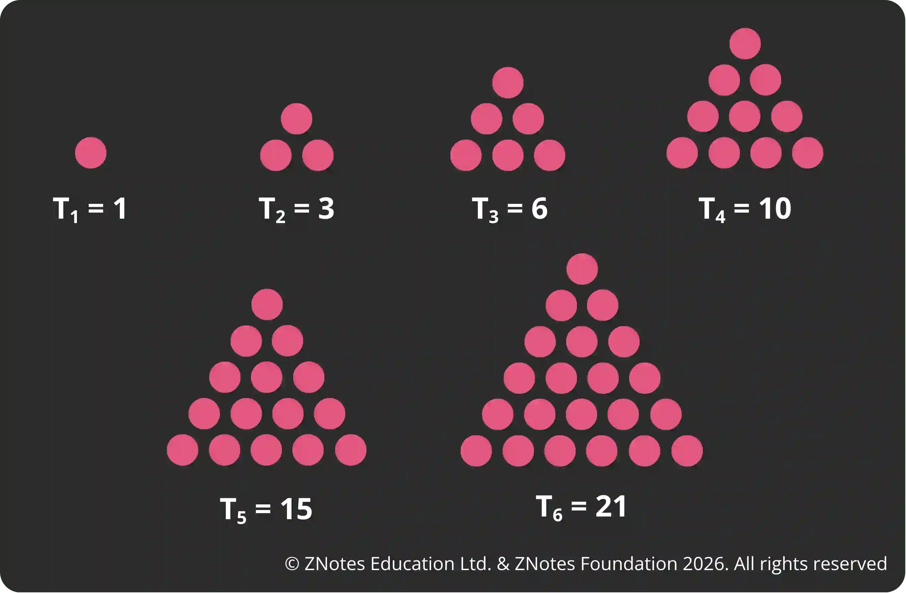
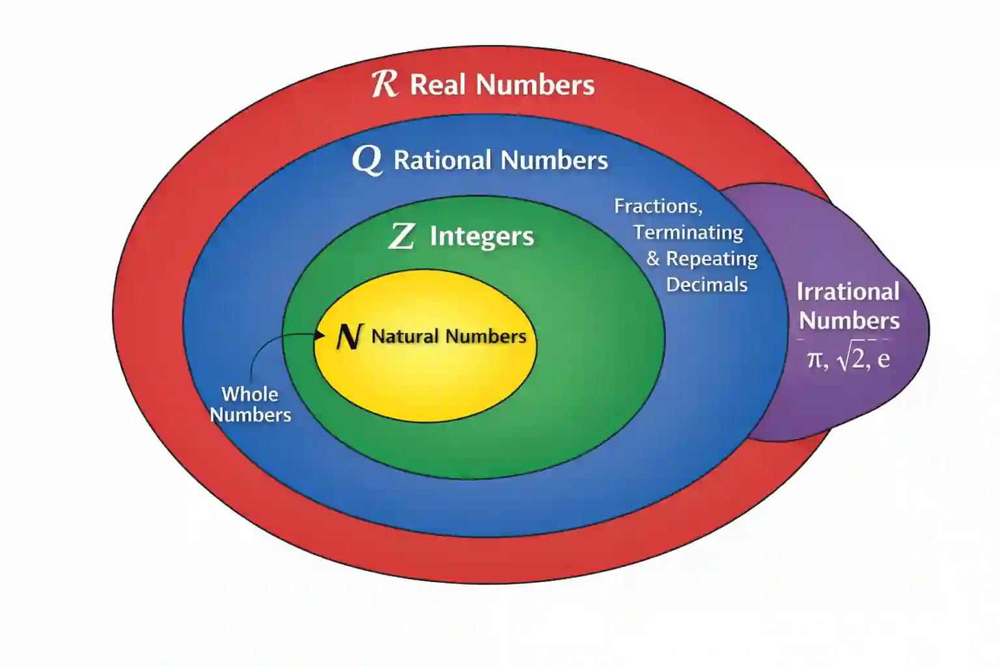

# Numbers

## Types of Numbers

**Real numbers**

* Real numbers are all types of numbers including integers, natural numbers, rational and irrational numbers.

* The set of real numbers is denoted by $ R $

**Natural numbers**

* Any whole number greater than 0

* Example: 1, 2, 3, 4, 5, 6…

* The set of natural number denoted by $ N $

**Integers**

* All the whole numbers including negative, positive, and 0

* Example: -4, -2, 0, 2, 4…

* The set of integers is represented by $ Z $

**Prime numbers**

* Numbers with only 2 factors: 1 and itself

* Example: 2, 3, 5, 7, 11…

* Remember:

  * 2 is the ONLY even prime number

  * 1 is NOT a prime number as it has only one factor (itself)

**Square numbers**

* A square number is a number obtained when an integer is multiplied by itself

* Form:  $ n^2 $

* Example: $ 2 \times 2  = 2^2 = 4 $

**Cube numbers**

* A cube number is a number obtained when an integer is multiplied by itself twice

* Form: $ n^3 $

* Example: $ 2 \times 2 \times 2 = 2^3 = 8 $

**Triangle numbers**

* A triangle/triangular number is a number obtained by adding the first T natural numbers

* Set of numbers that can be arranged in the shape of a equilateral triangle using dots

  * 1st triangle number = 1

  * 2nd triangle number = 1+2 = 3

  * 3rd triangle number = 1+2+3 = 6

**Reciprocals**

* A reciprocal number is a number that, when multiplied by the original number, gives 1

* $\text{Number} \times \text{Reciprocal} = 1$

* Example: $ 5 \times \frac{1}{5} = 1 $ , so $\frac{1}{5}$ is the reciprocal of 5

**Rational numbers**

* Any number that can be expressed in $\dfrac{p}{q}$, where p and q are integers and $ q \neq 0 $

* Decimal can either be terminating or recurring for example:

  * 0.25 can be written as $\frac{1}{4}$

  * $0.\bar{6}$ can be written as $\frac{2}{3}$

* The set of rational numbers can be denoted by $Q$

**Irrational numbers**

* Cannot be expressed in $\dfrac{p}{q}$ form

* Decimal is non-terminating and non-recurring

* Example: $\pi$ , $\sqrt{3}$

