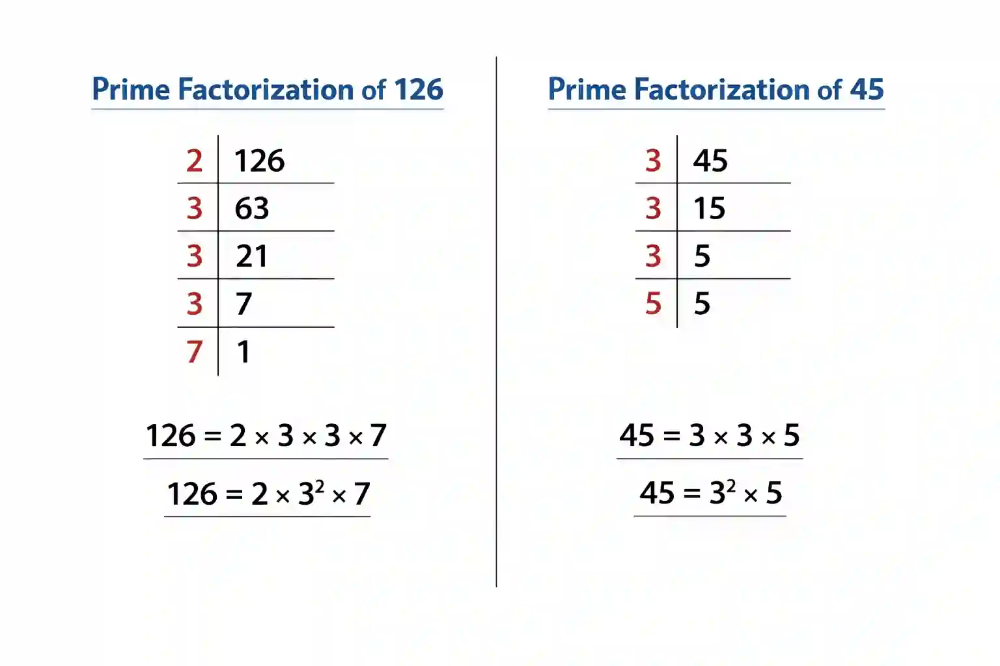

## Least Common Multiple (LCM)

* The LCM of two or more numbers is the smallest number that is a multiple of all the given numbers

### **Methods to find LCM**

**Prime Factorisation Method:**

* Write each number as a product of its prime factors
  * Example : $24 = 2^3 \times 3 \qquad 36 = 2^2 \times 3^2$
* Identify and multiply **all** the prime factors using the **highest power**
  * LCM = $2^3 \times 3^2 = 72$

**Ladder Method:**

* Write the numbers side by side

* Divide by the smallest prime number that divides *at least one* of the numbers

* If a number is not divisible, bring it down unchanged

* Continue until all numbers become 1

* Identify and multiply **all** the prime factors using the **highest power**

Remember LCM will always be greater than or equal to HCF

### Example: 126 and 45

* Identify and multiply **all** the prime factors using the **highest power**

* LCM = $2 \times 5 \times 7\times 3^2 = 630$