## Venn Diagrams

* Visual representation of the interaction between sets

* Union of $A$ and $B$

  $A \cup B$

  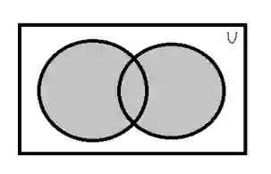

* Intersection of  $A$ and $B$

  $A \cap B$

  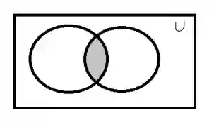

* Complement of $A$

  $A'$

  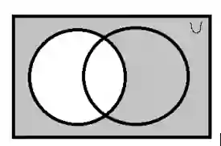

* Complement of $B$

  $B'$

  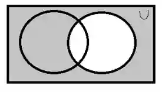

* Intersection of complement of $A$ and $B$

  $A' \cap B$
  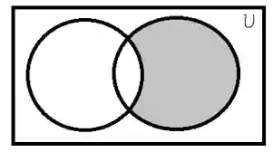

* Union of complement of $A$ and $B$

  $A' \cup B$

  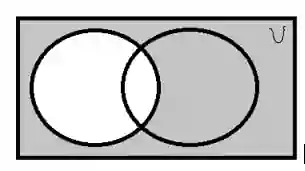

* Complement of $A \cup B$

  $A' \cup B'$

  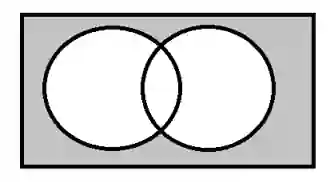

* Intersection of set $A$, set $B$, set $C$

  $A \cap B \cap C$

  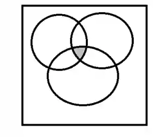

* The union of set $A$, set $B$ and the complement of set $C$

  * $A \cup B \cup C '$

    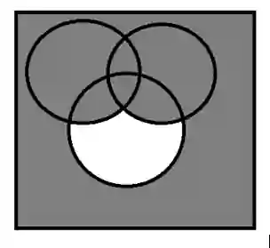

**Example :**

In a survey of **50 students**, 28 like **Ice cream (I) ,** 25 like **Chocolate (C) ,** 15 like **both** Ice cream and Chocolate

* How many students like **only Ice cream**?

* How many students like **only Chocolate**?

* How many students like **Ice cream or Chocolate**?

* How many students like **neither**?

**Answers**

Drawing a Venn Diagram will help understand problem better, so try drawing it roughly to gain better understanding

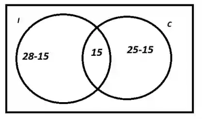

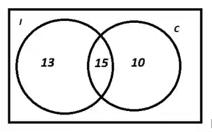

Only Ice cream = 13

Only Chocolate = 10

Neither Ice cream nor Chocolate = (50) - (13+15+10) = (50) - (38) = 12