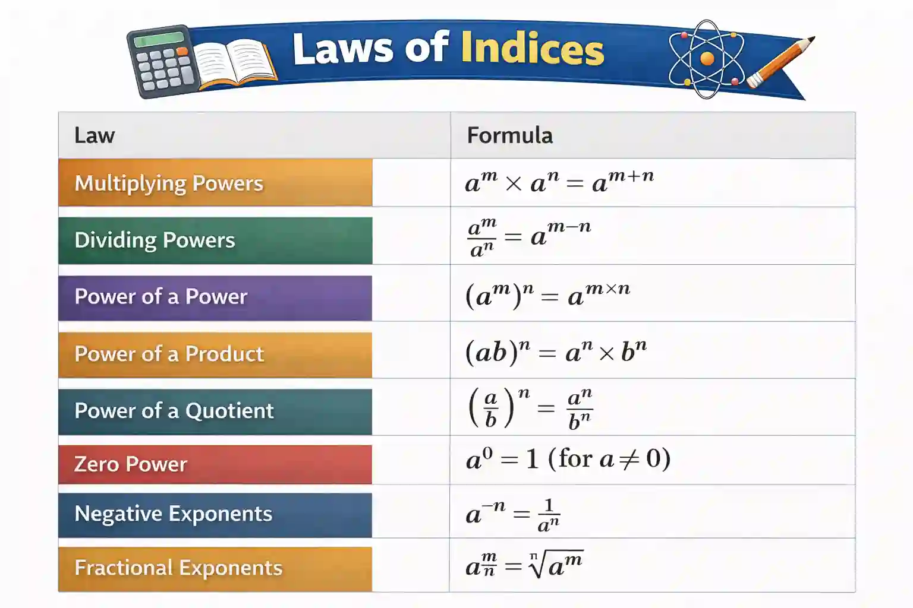

## Indices

### **Laws of Indices:**

Examples:

* $a^2 \times  a^6 = a^8$

* $a^6 \div a^2 = a^3$

* $(ab)^2 = a^2\times b^2$

* $(\dfrac{a}{b})^3 = \dfrac{a^3}{b^3}$

* $a^-2 = \dfrac{1}{a^2}$

* $a^\frac{2}{3} = \sqrt[3]{a^2}$